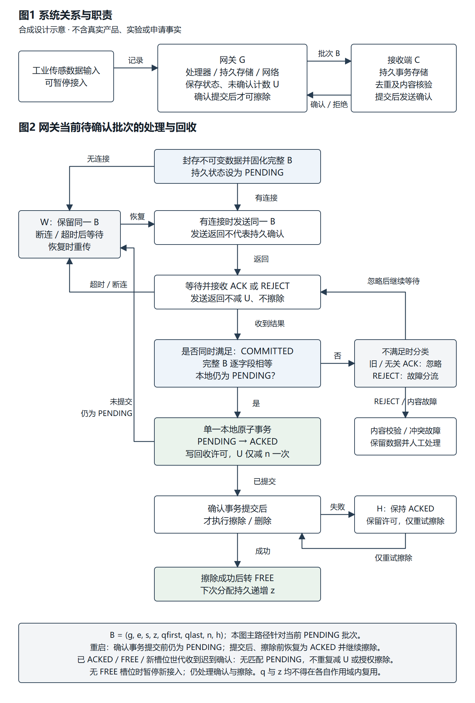
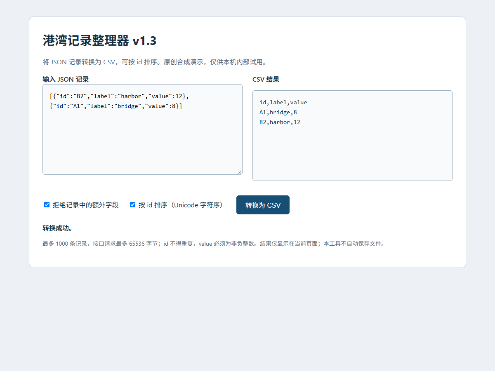

<!-- README_SYNC: source=working-tree; updated=2026-11-25 -->
<p align="center">
  简体中文 · <a href="./README_EN.md">English</a>
</p>

<div align="center">

# dyz-patent-copyright-skills

**把专利、软件著作权、技术标准三套专业流程装进你的 AI 助手。6 个 Skill 引导它先核原文、追问缺口再动笔，零依赖 Python 工具帮你核原句、抓常见条件反转和格式杂项（覆盖有限句式与规则子集），产出带原文映射、供专业人员复核的 Word 工作稿。**

如果你也被 AI 写专业材料时"看着很顺、一审全是坑"折腾过，欢迎点一个 [Star](https://github.com/duyunzhoudyz/dyz-patent-copyright-skills/stargazers) 收藏，也帮写交底、赶软著、起草标准的同行更容易找到它。

[](CHANGELOG.md)
[](https://github.com/duyunzhoudyz/dyz-patent-copyright-skills/actions/workflows/ci.yml)
[](RELEASE.md)
[](https://github.com/duyunzhoudyz/dyz-patent-copyright-skills/commits/main)
[](LICENSE)

<p>
  <a href="#写专业材料时普通-ai-为什么总帮倒忙">痛点与价值</a> ·
  <a href="#6-个-skill-各自帮你解决什么事">6 个 Skill</a> ·
  <a href="#跑一行命令立刻看效果">效果复现</a> ·
  <a href="#快速上手">快速上手</a> ·
  <a href="#它能帮你做什么又绝不越界做什么">能力边界</a> ·
  <a href="#架构与技术参考">CLI 与 MCP</a> ·
  <a href="#许可与商业授权">许可说明</a>
</p>

</div>

## 写专业材料时，普通 AI 为什么总帮倒忙？

普通大模型最大的毛病是太爱"顺着你往下编"，而且改完还特别通顺，隐患全藏在字面底下：

- **写专利交底书或权利要求**：原文明明写的是"只有记录已写入，才允许确认"，AI 嫌拗口，顺手润色成"一旦记录已写入，就允许确认"。读着差不多，但必要条件变成了充分条件，专利的保护范围直接写反。你没做过的温度或耗时实验，它也常为了段落好看，自己补一个看似合理的数字进去。
- **赶软件著作权登记材料**：很多人直接把 README 丢给 AI 扩写成操作说明书，或者让它编几个还没画出来的界面。交上去要么软件全称、版本号和源码对不上，要么因为材料脱离真实代码而被打回补正。
- **起草企业标准或团体标准**：标准正文里"应""宜""可"代表三种完全不同的要求强度，AI 写着写着就把强制要求软化成建议；遇到复杂概念，还容易写出用 A 定义 B、又拿 B 定义 A 的循环定义。

### 为什么做成「6 个 Skill + 本地 Python 工具」，而不是一段长提示词？

把规矩全塞进一段超长提示词，聊久了就容易被挤出上下文，换个模型严苛度也会跟着飘。

这个项目把工作拆成两层配合：**6 个 Skill 负责工作步骤引导**（教 AI 先核材料范围、追问真正影响结论的缺口，再按业务规则分步起草；它是流程约束，不是对大模型输出 100% 不出错的硬保证），适配 Claude Code、Cursor、Codex、Trae 等能读本地文件的 AI 助手；**零依赖的纯 Python 本地工具负责唱黑脸**，帮你核原句、抓常见条件反转和格式杂项（覆盖有限句式与规则子集）：对照原申请拦截已知句式的条件方向反转，把 Word 正文和内部审阅说明按目录分开存放，清洗 PNG 截图的多余辅助块，并生成段落到原文的源行映射，把缺少证据的地方留作明确缺口。

| 常见做法 | 装上这套 Skill 和本地工具之后 |
| --- | --- |
| 一个通用提示词同时应付专利、软著和标准 | 专利、软件版权、技术标准三条线各自按本行业规则判断，拆成 6 个 Skill 按需调用 |
| 缺参数、缺实验数据时，AI 顺手补全凑整齐 | 引导 AI 按给定材料起草并将缺失项单列为缺口，把"未知、未检查、不适用"分开记录 |
| 润色专利文本时改坏限定方向、丢掉原文支持 | 专利终稿门禁 2.1 对照原申请核查，拦截有限句式子集内的必要条件与充分条件反转等改动 |
| 赶软著时拿宣传介绍凑说明、凭空写界面 | 从获准源码清单提取事实，核对同版名称、版本号、真实源码行数与实拍界面 |
| 起草标准时把"应"写成"宜"，或引入循环定义 | 标准侧独立检查条款强度（"应/宜/可"）、规范引用、循环定义与验证依据 |
| 拿到一段聊天记录，还得自己复制排版和删批注 | 输出可编辑 Word 正文、矢量附图、原文行号映射和独立内部说明，改完还能回读核验 |

这套工具适合第一次写专利交底的工程师、自己整理软著材料的独立开发者、起草团标或企标的技术负责人，也适合想把交叉核对和整理工作交给 AI 辅助的专利代理师与企业 IP 团队。如果你指望点一下按钮就产出可直接递交官方的终稿，或者想省掉执业代理师、律师和标准化组织的审阅签核，它并不适合你，因为所有产出都只是待专业人员审阅的内部工作稿。

## 6 个 Skill 各自帮你解决什么事

你不需要从头跑完整个流程，也不必一开始就手写配置文件。按手头要办的事挑一个入口直接开干就行：

| 你手头要解决的事 | 选这个 Skill | 它实际帮你省掉哪些坑 |
| --- | --- | --- |
| 写专利交底书、权项、说明书，或核对已有草稿 | [专利 (`dyz-patent`)](skills/dyz-patent/SKILL.md) | 从代码、设计文档或论文里抽技术事实，先追问关键缺口再动笔；起草权项、说明书与附图方案，并反查每一句在原文的依据 |
| 收到审查意见（OA）、发论文或对外公开前先核查公开风险和原申请支持，或做自由实施排查（FTO，检查是否撞上别人专利）与绕开分析 | [程序与权利 (`dyz-procedure`)](skills/dyz-procedure/SKILL.md) | 收到通知先核原件、版本和紧急线索，不盲目动笔；逐条拆解审查意见并对照原始提交文件防超范围；侵权、自由实施排查（FTO）、无效、绕开四轨分开判断 |
| 整理软件著作权登记材料、处理补正，或追踪版本变动 | [软件版权 (`dyz-software`)](skills/dyz-software/SKILL.md) | 扫描获准源码清单，区分原创表达、第三方依赖和敏感信息；对齐软件名称、版本号与源码量，按真实界面或命令行写说明 |
| 起草企标、团标或国标草案、处理意见表，或准备送审五份配套文书（正文、编制说明、意见汇总表等） | [技术标准 (`dyz-standards`)](skills/dyz-standards/SKILL.md) | 梳范围、定术语、写条款和验证计划；专门查"应/宜/可"强度、循环定义和引用冲突；把征求意见表、改文与编制说明对应起来 |
| 导出干净的 Word / PDF 工作稿，或把人工改完的 Word 再查一遍 | [渲染与核稿 (`dyz-rendering`)](skills/dyz-rendering/SKILL.md) | 把对外正文和内部风险批注分目录存放；装配审阅包后，静态回读会列出可识别的 XML 批注/修订标记、核对受控标记字节与正文字面/附图清单差异（隐藏内容是否彻底清除、自动编号与实际分页裁切仍需人工核对及转 PDF 逐页实看） |
| 一个项目同时要做专利、软著、标准，或隔几天回来接着干 | [共享工作台 (`dyz-workbench`)](skills/dyz-workbench/SKILL.md) | 统一做任务分流、材料权限核对与跨轮交接；不同业务可以复用同一份已核事实，但各自的状态与签核保持独立 |

可以从很小的单步任务切入，例如"只帮我对照原稿改第 1 条，并列出正文和附图里要跟着改的地方"。6 个 Skill 共用同一棵 `tools/` 和 `references/` 目录树，不要把某个 `SKILL.md` 单独复制出去当作独立安装包运行工具。

## 跑一行命令立刻看效果

下面两个例子于 `2026-11-25` 在本机 Windows（Python `3.14.6`）实测复现，不装任何第三方包，也不联网。

### 1. 一句改动如何写反保护范围，门禁直接拦下

原申请写的是**"只有记录已写入，才允许确认。"**（写盘是允许确认的前提，但未必写盘后就一定放行）。AI 润色时如果顺手改成**"一旦记录已写入，就允许确认。"**（只要写盘就放行），必要条件就被改成了充分条件。专利终稿门禁 2.1 在交稿前会对照原申请核对这类逻辑反转：

| 原文 | AI 改出的候选终稿 | 门禁结果 | 说明 |
| --- | --- | --- | --- |
| 只有记录已写入，才允许确认。 | 只有记录已写入，才允许确认。 | `checked` | 限定关系与原文一致 |
| 只有记录已写入，才允许确认。 | 一旦记录已写入，就允许确认。 | `blocked` | 必要条件被改成充分条件，触发阻断 |

在仓库根目录复制运行这一行命令，会直接输出 `ok: checked bad: blocked`：

```powershell
python -B -X utf8 -c "from tools import patent_gate; from tools.core import sha256_bytes; s='只有记录已写入，才允许确认。'; orig=[{'id':'O1','version':'1','role':'original','text':s,'sha256':sha256_bytes(s.encode())}]; print('ok:', patent_gate.audit_final_text({'claims':s}, orig)['status'], 'bad:', patent_gate.audit_final_text({'claims':'一旦记录已写入，就允许确认。'}, orig)['status'])"
```

这里的 `blocked` 表示程序没能在原文里核到支持，不等于法律意义上的最终认定；门禁覆盖有限规则子集，详见[它能帮你做什么，又绝不越界做什么](#它能帮你做什么又绝不越界做什么)。

### 2. 正文与内部说明分目录存放的 Word 审阅包

跑一遍下方[快速上手](#快速上手)里的第 3 步，工具会用仓库自带的合成专利示范组装出完整审阅包并自动回读校验，产出 7 份文件（对外正文放 `body/`，内部审阅说明放 `internal/`，方便交付前人工分开核对）：

| 文件路径 | 做什么用 |
| --- | --- |
| `body/document.docx` | 可直接编辑的 Word 正文，不混入任何内部提醒或风险批注 |
| `body/GatewayFigures.svg` | 可编辑的矢量附图 |
| `body/source.txt` | 正文对应的源文本 |
| `internal/source-map.json` | 段落与原文的源行映射，方便逐句回查 |
| `internal/notes.txt` | 内部撰写与审阅说明，和 `body/` 物理分离 |
| `internal/quality-review.json` | 机器检查结果与未执行项清单 |
| `manifest.json` | 整包清单、文件哈希与 `needs_review` 状态 |

下面两张预览图均来自仓库自带的合成示范资源，不含真实案件或客户材料：

<table>
  <tr>
    <td width="42%" valign="top"></td>
    <td valign="top"></td>
  </tr>
  <tr>
    <td>合成专利示范附图（仓内自带合成资源）</td>
    <td>软件版权合成示范演示软件 v1.3 界面截图（仓内自带合成资源）</td>
  </tr>
</table>

## 快速上手

只需要 **Python 3.11 至 3.14 标准库**，核心工具零 `pip` 依赖。克隆完整源码或解压已校验的本地运行包后，保持 `tools/`、`skills/`、`references/` 的相对目录位置即可。想走完专利、软著、标准与 MCP 四条线演练，可直接看[3 分钟开箱实操剧本](skills/dyz-workbench/resources/quickstarts.md)。

### 玩法一：直接让 AI 助手读 Skill 开写（不用写 JSON）

本地工具默认离线，但如果你用的是云端大模型，发给助手的材料依然会经过模型服务商；喂入未公开技术或客户源码前，请先核对保密要求。建议初次上手直接用仓库自带的公开合成样例 [cn-gateway-example.md](skills/dyz-patent/resources/cn-gateway-example.md) 试跑，不需要加载任何真实项目或客户材料（实际数据去向仍由所用 AI 宿主决定）。

在 Claude Code、Cursor、Codex、Trae 等支持读取本地文件的 AI 宿主里打开本项目目录，按任务指向对应 `SKILL.md` 即可，比如：

> "请先阅读 `skills/dyz-patent/SKILL.md`，只依据 `skills/dyz-patent/resources/cn-gateway-example.md` 中的第 0.1 节合成设计摘要起草专利交底书内部工作稿；每条事实标清原文段号，没给的数据留空并列成缺口清单，不要自己补参数。"

这条指令要求助手交出两部分内容：一份每条事实都标有原文段号的内部工作稿，以及一份列明缺少哪些参数、实验或背景依据的缺口清单（实际结果仍须人工对照原文核验）。

### 玩法二：4 步跑通本地工具、Word 审阅包与 MCP 预览

**第 1 步：核对 Python 版本与 83 项能力目录**

```powershell
python --version
python -B -X utf8 -m tools help
python -B -X utf8 -m tools list
```

`python --version` 应为 `3.11.x` 至 `3.14.x`；`help` 列出全部 CLI 子命令（`python -B -X utf8 -m tools help <topic>` 可查指定子命令参数）；`list` 输出 11 个能力域共 83 项 `synthetic_helper_only` 目录 JSON。

**第 2 步：运行内建合成演练，确认外联连接器默认离线**

```powershell
python -B -X utf8 -m tools demo --synthetic --root . --output synthetic-demo.json
python -B -X utf8 -m tools connector-status
```

`demo` 会在根目录生成 `synthetic-demo.json` 并输出 `result_written`；`connector-status` 输出 `status: "offline_by_default"` 与 `network_requests: 0`。

**第 3 步：生成并回读合成专利 Word 审阅包**

```powershell
python -B -X utf8 -m tools.documents --synthetic --root . --input skills/dyz-rendering/resources/document-example.json --output patent-review-pack
python -B -X utf8 -m tools.documents --synthetic --root . --input skills/dyz-rendering/resources/document-example.json --output patent-review-pack --verify
```

两条命令依次输出 `document_written_needs_review` 和 `document_verified_needs_review`。输出目录必须事先不存在且位于 `--root` 之内，放在仓库根目录会被 Git 忽略。PDF 转换是显式可选项，依赖本机 LibreOffice，初次体验不需要。

**第 4 步：预览多宿主安装计划与 MCP（stdio）配置片段**

```powershell
python -B -X utf8 -m tools.install --target ./dyz-installed-preview --host claude-code --plan
python -B -X utf8 -m tools.mcp_server --print-config --host claude-code
```

两条命令都只打印输出，**不写盘，也绝不改动全局宿主配置**。`--host` 均支持 `claude-code`、`cursor`、`codex`、`trae`、`generic`；其中 `tools.mcp_server --print-config --host codex` 输出 TOML，其余宿主及 `tools.install --plan` 输出 JSON。

## 它能帮你做什么，又绝不越界做什么

先把版本状态和边界摊开讲清楚，用着才踏实。当前正式发布版本为 **`0.1.1`**（主分支 `main`，发布标签 `v0.1.1`，发布日期 `2026-11-25`）。11 个能力域、83 项能力目录当前全部维持 `synthetic_helper_only`，即提供可核查的起草方法、合成示范与有限本地工具。完整发布范围、维护者元数据与版本变化见[发布说明](RELEASE.md)、[release.json](release.json) 和[变更记录](CHANGELOG.md)。

### 实测基线与明确未执行项

| 维度 | 当前状态 | 准确范围与说明 |
| --- | --- | --- |
| 跨平台本地工具基线 | 已实测通过（12 / 12 全绿） | `release.json` 中的 `verified_platforms` 与 `supported_platforms` 同步升级为 Windows / Linux (Ubuntu) / macOS × Python `3.11 / 3.12 / 3.13 / 3.14`（纯标准库本地工具与自动化单测范围）。具体实证：合并态 `main@697d8a2` 在本机 Windows（Python `3.14.6`）上全仓 **`2,145 / 2,145`** 项单元测试通过（0 失败、0 错误、0 跳过），`compileall`、`validate_readme_pair.py` 与 `evals/release_check.py --publication` 均通过（此前 Windows Python `3.11 / 3.12 / 3.13 / 3.14` 本机基线均已验证）；同提交于 `2026-11-25` 在托管 GitHub Actions [run 45592934144](https://github.com/duyunzhoudyz/dyz-patent-copyright-skills/actions/runs/45592934144) 上实现 `windows-latest` / `ubuntu-latest` / `macos-latest` × Python `3.11 / 3.12 / 3.13 / 3.14` 共 **12 / 12 全部通过**（含 `release_check.py`、`compileall` 与全仓本地测试；Linux / macOS 上保留 4 项预期平台跳过：2 项 Windows junction、1 项 Windows 大小写碰撞、1 项可选外部 PDF 工具测试）。`v0.1.1` 发版合并前会复跑全量测试，最新工作流状态以 [GitHub Actions](https://github.com/duyunzhoudyz/dyz-patent-copyright-skills/actions/workflows/ci.yml) 为准。 |
| 明确未执行项 | 未执行 | 真实外联请求（`tools/connectors/` 默认离线，只在显式披露授权并绑定主机、用途、规范化查询、分页范围、有效期与硬预算上限后才允许只读外联，本机未执行真实联网请求）、跨平台 Office / LibreOffice / Poppler 实页视觉与分页复核、付费模型真人盲测（`evals/benchmark_harness.py` 仅完成离线夹具协议自检）以及人类执业人员专业签核。 |

### 这套工具绝不替代的事情

- **机器检查通过不等于专业签核**：`checked`、零 issues、Word 顺利生成或 PDF 字面一致，都不能说明稿件可以直接提交、登记、认证或已获组织批准；所有产出均为等待人工和专业人员复核的内部工作稿，不替代专利代理师、执业律师、软件版权审查员或标准化组织的判断。
- **专利门禁 2.1 与美欧形式分析只覆盖有限规则子集**：从属权项继承链、结构锚点、有限英文条件关系、OA 双轨核验与 US/EP 形式检查，都不是完整法律审查或等同原则判定。触发 `blocked` 时请保留原件，只交付标明"未完成检查"的内部工作稿交专业人员复核。
- **默认离线，不执行真实外部办理，也不提供操作系统级沙箱**：`tools/connectors/` 默认完全离线且仅在显式披露授权与预算限额下支持只读外联。项目没有任何正式提交、自动外发、电子签章或付款功能。
- **本地工具离线不等于云端大模型离线**：如果你用的是云端模型，喂进去的材料依然会走宿主的数据通道。加载未公开技术、客户源码或受限标准前，先确认你的合规边界。
- **合成入口只处理合成样例**：不要把真实案件改标成合成材料绕过限制；真实软件与标准材料请走各自显式获准的本地入口。
- **宿主自动发现与跨平台排版需在目标环境另验**：`tools/mcp_server.py` 与 `tools/install.py` 不改写全局宿主配置；真实模型多轮往返稳定性以及 Linux / macOS 下的 LibreOffice / Poppler 实页分页效果须结合你的实际环境另行核验。

## 架构与技术参考


同一项目可以在不同业务之间复用经授权的底层事实，但三条业务的状态、版本、公开范围和交付物各自独立。Skill 里的流程文字不是技术隔离，跨业务披露与外发审批设计见[跨子系统交接与披露审批](docs/disclosure-and-handoff.md)。

| 子系统 / 层 | 负责什么 | 不替代什么 |
| --- | --- | --- |
| 专利 | 检索策略、交底、可专利空间、权项、说明书与附图、核稿、审查答复、侵权与 FTO、组合管理 | 软件版权登记判断、技术标准共识与发布批准 |
| 软件著作权与软件版权 | 权属与版本、真实源码与说明文档、交存登记、补正变更、版权争议证据 | 专利性、保护范围与不侵权结论 |
| 技术标准 | 体系研究、立项、术语与条款、试验验证依据、意见处理、国际采用、送审交接与修订 | 专利必要性认定、标准化组织批准、产品认证 |
| 共享基础层 | 材料与证据、权限、术语与版本、差异、绘图与导出、审核记录、评测执行 | 任何专业判定；规则、通过条件与签核归各专业子系统 |

### MCP 服务端、多宿主安装器与 `HostToolBridge` 10 工具安全边界

| 模块 | 工作方式与约束 |
| --- | --- |
| `tools/mcp_server.py` | 纯标准库 JSON-RPC 2.0 `stdio` 服务端，自动识别 `Content-Length` 与 NDJSON 帧。**拒绝裸跑**，启动时必须二选一：显式传 `--catalog-only` 只暴露只读目录工具 `dyz_catalog`，或绑定已验证运行包、工作区、控制目录与包外清单哈希（`--package`、`--workspace`、`--control`、`--manifest-sha256`）后才暴露 10 项 `HostToolBridge` 工具。运行 `python -B -X utf8 -m tools.mcp_server --describe` 可看全部 11 个工具定义。 |
| `HostToolBridge` 10 工具 | 包括 `case_read`、`case_write`、`case_info`、`case_copy`、`case_image`、`case_documents`、`case_docx_review`、`case_fidelity`、`case_standard_package`、`case_software`。通过 `tools/mcp_server.py` 绑定运行包或命令行调用 `tools.host_bridge` 时**必须**传 `--manifest-sha256`；在 Python 中针对独立运行包构造 `HostToolBridge` 时**必须**传 `expected_manifest_sha256`（与 `tools.bundle --verify` 不带哈希时仅做内部一致性检查不同）；运行期对运行包只读且仅限清单内文件与 `bundle-manifest.json`（核对已加载哈希）；工作区只开放 `input/`、`work/`、`output/` 读取，写入限于 `work/` 与 `output/`，受路径边界与防符号链接/重解析点保护，契约见[本地文件工具说明](skills/dyz-workbench/resources/host-bridge.md)。 |
| `tools/install.py` | 跨平台本地安装与防篡改校验器，支持 `--plan` 仅预览不写盘、安装 309 源冻结运行包与宿主索引/MCP 配置样例，以及 `--verify` 核对包外哈希，从不改写全局宿主配置。 |

<details>
<summary>展开查看全部 26 条 CLI 子命令与专业工程扩展入口</summary>

运行 `python -B -X utf8 -m tools help` 查看全部子命令，运行 `python -B -X utf8 -m tools help <topic>` 查看指定子命令的参数说明。

| 分组 | 子命令 | 用途与边界 |
| --- | --- | --- |
| 基础探索与合成演练 | `help`、`list`、`demo`、`run`、`preview` | 总帮助与子命令帮助、83 项目录、内建披露演练、单能力合成运行、固定快照 HTML 预览 |
| 专利与策略核验 | `check-patent-ir`、`build-patent-pack`、`verify-patent-pack`、`check-jurisdiction`、`check-strategy` | 权项-事实 IR 与起草骨架、合成专利包构建与包外摘要哈希回验、US/EP 权项结构子集分析、不建议申请 / FTO / SEP 分轨核对 |
| 视觉、模板与治理 | `check-visual-ledger`、`check-capture-manifest`、`inspect-template`、`check-trial-upgrade`、`connector-status` | 页面实看与跳过台账、截图清单与 PNG 辅助块清洗核验、只读 DOCX/DOTX 模板安全检查、试审包连续三案门控核对（不自动升级支持等级）、默认离线连接器策略查询 |
| 软件版权本地链 | `software-intake`、`discover-software`、`prepare-software`、`import-software-manual`、`build-software`、`export-software`、`software-batch` | 集中采集、获准清单候选发现、内部准备、新稿导入、DOCX/PDF 生成与分批状态索引；不自动外发 |
| 技术标准本地链 | `standard-intake`、`prepare-standard`、`migrate-standard-comments`、`standard-pdf` | 标准五文书 v2 采集、生成与回验、旧意见表显式迁移、按固定授权转 PDF 并取逐页证据 |

其他专业模块与参考资源：专利门禁 2.1（`tools/patent_gate.py`）、原生 Word OMML 数学公式（`tools/omml.py`）、默认离线外联策略层（`tools/connectors/`）、[获准软件成品链与集中采集](skills/dyz-software/resources/tools.md#软件成品链与集中采集)、[标准五文书闭环与 v3 排版](skills/dyz-standards/resources/tools.md#五文书闭环与本地入口)、[文件装配](skills/dyz-rendering/resources/tools.md)、[编辑后 Word 回查](skills/dyz-rendering/resources/docx-readback.md)与[有限公开专利检索附录](skills/dyz-patent/resources/cn-gateway-search.md)。

</details>

### 源码仓库（415 文件）与完整本地运行包（309 源文件）

仓库把开发用的完整源码树和发给接收方的精简运行包明确分开：

| 范围 | 文件数 | 包含内容 | 不包含 |
| --- | --- | --- | --- |
| Git 源码仓库 | `source_candidates: 415` | 6 个 Skill 及其运行资源、`tools/`、获准 `references/`、白名单设计文档、`evals/` 测试与合成夹具、`.github/` CI 定义、`README_EN.md`、许可与发布元数据 | 本地施工台账、竞品研究快照、历史模型答卷、`outputs/`、`tmp/`、本地私有配置与私人案件 |
| 本地完整运行包 | `bundle_source_files: 309` | 6 个入口、共享 `tools/`、运行资源、白名单文档与许可文件，外加 `bundle-manifest.json` | 源码仓库内的可运行测试、合成夹具、CI 定义与开发检查器（这些开发材料不随本地包分发）；`README_EN.md` 也仅随源码仓库提供，未列入本地包白名单 |

需要单独交付运行时文件时，可在根目录按固定白名单打包，并用包外保存的清单 SHA-256 校验（目标目录须不存在且父目录存在）：

```powershell
python -B -X utf8 -m tools.bundle --destination D:/dyz-local-bundle
$dyzManifestSha = (Get-FileHash -LiteralPath D:/dyz-local-bundle/bundle-manifest.json -Algorithm SHA256).Hash.ToLowerInvariant()
python -B -X utf8 -m tools.bundle --verify D:/dyz-local-bundle --manifest-sha256 $dyzManifestSha
```

构建输出 `bundle_created`，校验返回 JSON 中的 `"status": "matched"`。清单哈希应由构建者在包外保存并交给下载者比对，不能从待验包自身现算一个"预期值"；不带包外哈希的校验只能说明内部一致，两种校验都不认证来源、许可或专业质量。布局、按需加载与恢复细节见[完整包使用说明](skills/dyz-workbench/resources/package-use.md)。

根目录与 `docs/` 在 `.gitignore` 中采用白名单管理，`.gitattributes` 关闭换行转换以保留源行映射和合成夹具的原始字节。切勿把客户源码、未公开交底书、证件、签章资料或受限标准全文放进公开仓库；私人案件资料请放到独立目录或被忽略的 `private/` 目录。Git 忽略既不是加密也不是访问控制，推送前仍须核对实际跟踪清单。

## 和同类公开 Skill 的关系

社区里已有不少公开 Skill 把其中某一环节做得很实用。下表依据 `2026-11-02` 读取的固定提交做静态源码观察，没有在相同输入、模型和环境下对照实测，也不是效果排名：

| 方向 | 代表项目（固定提交） | 源码观察里值得借鉴的地方 | 本项目的侧重点 |
| --- | --- | --- | --- |
| 专利 | [paper2patent](https://github.com/7toCR/paper2patent/tree/53d0a2d2cbd8db6de824dfed86aab1763caa7142)、[patent-disclosure-skill](https://github.com/handsomestWei/patent-disclosure-skill/tree/0b95b547f78c2a0dd0e4e71eb43a88841c99c936) | 串联权项、附图、DOCX/PDF 与独立撰写说明；清晰的多任务路由 | 原文支持链、逐文献比较、修改影响追踪与程序交接 |
| 软件版权 | [SoftwareCopyright-Skill](https://github.com/Fokkyp/SoftwareCopyright-Skill/tree/1159f6d280783616e1247f768690eac97c1a3f6e)、[software-certificate-skill](https://github.com/IvanCodesDev/software-certificate-skill/tree/ee7d4636f35210767adc0b5689f8678c68e6f7e6) | 串联选材与文档生成；真实界面截图与版本变化后局部重建 | 表达、权利与许可分流、同版事实一致与版本失效追踪 |
| 技术标准 | [gbt-standard-docx-skill](https://github.com/zhangzhangco/gbt-standard-docx-skill/tree/a3af82bc790b0dcf9c2eb8c7123df46311da68da) | DOCX 模板、交叉引用与修改意见表工作流 | 条款与验证依据对应、意见处理与修订影响、公开前 IP 交接 |

本项目不以测试数量、星数或文档篇幅宣称在工程或专业写作上胜过其他项目，也未引入任何上游实现代码。完整静态对比见[GitHub 横向比较](docs/github-skill-comparison-20261102.md)与[固定版本来源索引](docs/github-skill-comparison-20261102-sources.json)，上游许可与复用边界见[第三方说明](THIRD-PARTY-NOTICES.md)。

## 文档、参与贡献与安全报告

<details>
<summary>展开查看 6 份核心设计文档索引</summary>

- [全球能力蓝图](docs/capability-blueprint.md)：11 个能力域、83 个顶层能力 ID、三专业分工与适配边界。
- [能力契约与覆盖矩阵](docs/capability-contracts.md)：输入、输出、责任与验收要求（规格覆盖不等于能力已实现）。
- [跨子系统交接与披露审批](docs/disclosure-and-handoff.md)：权限、版本、签核、外发与事件处置设计。
- [实施路线与质量门槛](docs/roadmap-and-quality.md)：长期目标、依赖与验证边界（计划不是当前支持）。
- [项目施工规范](docs/development-standards.md)：目录、技能、规则、代码与分层验证约定。
- [参考项目源码分析](docs/reference-analysis.md)：固定版本来源、许可与复用边界。

</details>

欢迎通过 [Issues](https://github.com/duyunzhoudyz/dyz-patent-copyright-skills/issues) 和 Pull Requests 改进方法、文档、合成样例与本地工具，具体步骤见[贡献指南](CONTRIBUTING.md)。拟合并的原创贡献须由有权贡献者明确同意[贡献许可](CONTRIBUTOR-LICENSE.md)（贡献者保留版权，同时向 [release.json](release.json) 载明的项目授权接收主体 **杭州溥源智能科技有限公司** 授予商业再许可所需权利）并附 `Signed-off-by`；未完成书面授权确认的外部补丁仅作讨论和审阅，不先行合并。

提交改动前，请在完整源码根目录运行与 `.github/workflows/ci.yml` 一致的三步检查（全量测试通常需数分钟）：

```powershell
python -B -X utf8 evals/release_check.py
python -B -X utf8 -m unittest discover -s evals -q
python -B -X utf8 -m compileall -q tools evals skills
```

敏感安全问题请按[安全报告说明](SECURITY.md)走私密渠道处理。[release.json](release.json) 中 `security_contact` 当前为 `AI4anyone(wechat)`；首次联系请先核实维护者身份并确认接收方式，再仅发送脱敏后的最小必要信息，切勿在公开 Issue 或 PR 中附带复现载荷、客户材料、未公开技术或凭证。

## 许可与商业授权

本项目原创内容采用 [PolyForm Noncommercial License 1.0.0](LICENSE) 加单独商业授权，属于 **Source Available（源码公开）** 模式。

在遵守 [LICENSE](LICENSE) 通知保留义务的前提下，免费允许范围包括：非商业用途、无预期商业应用的个人用途（其中个人用于研究、实验与测试限于增进公共知识，另含个人学习、业余项目等），以及 [LICENSE](LICENSE) 明示列明的非商业机构（慈善组织、教育机构、公共科研机构、公共安全或卫生机构、环境保护机构、政府机构）自身按条款开展的使用（按 [LICENSE](LICENSE) 原文不受资金来源或资助义务限制，但商业主体自身仍须另行获取商业许可）。完整权利边界以 [LICENSE](LICENSE) 原文为准，本说明不缩减其已授予权利。

个人身份不自动使商业用途免费。超出 [LICENSE](LICENSE) 允许范围的商业用途（如企业内部研发与 IP 业务流程、代理所或律所收费服务、商业 SaaS 集成或商业再分发）须事先取得书面商业授权，常见场景与路径见[商业授权说明](COMMERCIAL-LICENSE.md)。第三方研究材料与 EPO 有限公开数据继续适用其各自原许可，见[第三方说明](THIRD-PARTY-NOTICES.md)。

原创内容权利人与商业授权主体为 **杭州溥源智能科技有限公司**，商业授权联系邮箱为 `402784717@qq.com`（与 [release.json](release.json) 及[发布说明](RELEASE.md)一致）。源码公开、下载、询价或阅读本说明均不代表已获得商业许可。

---

如果这套工具帮你在写交底、赶软著或核标准时少返一次工，点一个 [Star](https://github.com/duyunzhoudyz/dyz-patent-copyright-skills/stargazers) 留着备用吧。碰到报错或规则盲区，欢迎直接提 [Issue](https://github.com/duyunzhoudyz/dyz-patent-copyright-skills/issues) 或按[贡献指南](CONTRIBUTING.md)发起 Pull Request。
