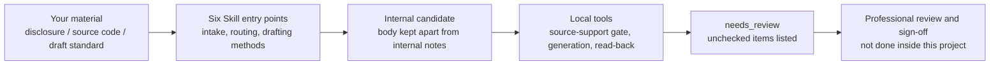

<!-- README_SYNC: source=working-tree; updated=2026-11-25 -->
<p><a href="./README.md">简体中文</a> · English</p>

# dyz-patent-copyright-skills

**Agent Skills and local tools for patent, software-copyright and technical-standard work: the model drafts and checks only against the material you supply, lists source support and gaps item by item, and every output is an internal candidate awaiting professional review.**

If this approach is useful to you, give it a [Star](https://github.com/duyunzhoudyz/dyz-patent-copyright-skills/stargazers) to bookmark it and to help others with the same problem find it.

[](https://github.com/duyunzhoudyz/dyz-patent-copyright-skills/stargazers)
[](https://github.com/duyunzhoudyz/dyz-patent-copyright-skills/actions/workflows/ci.yml)
[](https://github.com/duyunzhoudyz/dyz-patent-copyright-skills/issues)
[](CHANGELOG.md)
[](RELEASE.md)
-3776AB)

[](LICENSE)

[](https://github.com/duyunzhoudyz/dyz-patent-copyright-skills/stargazers)

> **Status:** `0.1.0a1` is a pre-release candidate: no tag or GitHub Release has been cut, and the proposed tag is `v0.1.0-alpha.1`. All 83 catalog entries across 11 capability domains are rated `synthetic_helper_only`: methods, synthetic examples and limited checks are available, which is neither full professional capability nor a promise that any filing will succeed. Scope and open items are in the [release notes](RELEASE.md); changes are in the [changelog](CHANGELOG.md).
>
> **Language:** the skills, their resources and the linked documents are written in Chinese. This file is the English entry point.

## What problem it addresses

Ask a large model to write a patent draft, software-copyright filing material or a standard clause, and the prose usually reads well. The trouble is in what you cannot see: a parameter the source never mentioned, "only if" polished into "once", "shall" softened to "should", or something nobody searched for reported as "none found". The sentence reads almost the same; the claim scope, the registered facts or the strength of the requirement has changed.

This project turns those risks into practices you can check:

| Common practice | What happens here |
| --- | --- |
| One general prompt covers patents, software copyright and standards | Three lines of work judge separately; evidence, versions and tools are shared, routed through six Skill entry points |
| The model fills in a parameter, an experiment or a source | Only the supplied material is used; what is missing is listed as a gap, and unknown, unchecked and not-applicable are recorded separately |
| Polishing quietly changes a limitation or the strength of a requirement | The patent final-text gate compares against the source; a sentence that changes the limiting relation is blocked |
| The deliverable is a chat transcript | An editable Word file, a source-line map and separate internal notes, which can be read back and verified after generation |
| A check script finishes and the result says "passed" | Results are marked `needs_review`, everything not done is listed as `not_performed`, and professional sign-off is recorded separately |

**A good fit:** patent attorneys, in-house IP and R&D teams, people preparing software-registration material and standards drafters who already use an agent that can read local files and need traceable internal working drafts.
**Not a fit:** anyone looking for one-click, ready-to-file documents, or for a replacement for the judgement of attorneys, lawyers or standards bodies.

## An example you can reproduce

The results below were produced on 2026-11-17 on Windows with Python 3.11.15.

**The final-text gate.** A patent final text is compared with the original application text before it is handed over. Both rows use the same source sentence:

| Source text | Candidate final text | Result |
| --- | --- | --- |
| 只有记录已写入，才允许确认。 (Confirmation is allowed only if the record has been written.) | 只有记录已写入，才允许确认。 (unchanged) | `checked` |
| 只有记录已写入，才允许确认。 (Confirmation is allowed only if the record has been written.) | 一旦记录已写入，就允许确认。 (Once the record has been written, confirmation is allowed.) | `blocked` |

The second row turns a necessary condition into a sufficient one. It reads almost the same, the limiting relation is different, and the gate stops it. `blocked` means the gate could not find support in the source text; it is not a finding that no basis exists. The gate covers a limited syntax only, see [What this release does not do](#what-this-release-does-not-do).

**A closed file loop.** Step 3 of the [Quick start](#quick-start) builds a review pack from the synthetic patent example in this repository and reads it back:

| File | Content |
| --- | --- |
| `body/document.docx` | Editable Word body |
| `body/GatewayFigures.svg` | Editable figures |
| `body/source.txt` | Body text |
| `internal/source-map.json` | Source-line map |
| `internal/notes.txt` | Internal notes, kept out of the body |
| `internal/quality-review.json` | Quality-check record |
| `manifest.json` | Pack manifest and status |

<table>
  <tr>
    <td width="40%" valign="top"></td>
    <td valign="top"></td>
  </tr>
  <tr>
    <td>Figures of the synthetic patent example</td>
    <td>Screenshot of demo software v1.3 used by the synthetic software-copyright example</td>
  </tr>
</table>

Both images are synthetic example resources shipped with the repository. They contain no real case.

## Quick start

Environment: **Python 3.11–3.14 standard library**, with zero mandatory pip dependencies for the core tools. The locally verified baseline is Windows with Python 3.11, 3.13 and 3.14; Windows Python 3.12 and Ubuntu / macOS (Python 3.11 / 3.12 / 3.13 / 3.14) have cross-platform guards and CI matrix definitions awaiting live hosted Actions runs. Download the complete source tree or a trusted complete bundle, keep `tools/`, `skills/` and `references/` in their relative positions, and run commands from the root; see the 3-minute playbooks in [quickstarts.md](skills/dyz-workbench/resources/quickstarts.md).

**1. Check the interpreter**

```powershell
python --version
```

It should print 3.11.x through 3.14.x (locally verified on 3.11, 3.13 and 3.14; 3.12 awaits hosted CI).

**2. View help, list the capability catalog and run a synthetic rehearsal**

```powershell
python -B -X utf8 -m tools help
python -B -X utf8 -m tools list
python -B -X utf8 -m tools demo --synthetic --root . --output synthetic-demo.json
```

`list` prints a JSON catalog with 83 entries; `demo` prints `result_written`.

**3. Build a synthetic Word review pack and read it back**

```powershell
python -B -X utf8 -m tools.documents --synthetic --root . --input skills/dyz-rendering/resources/document-example.json --output patent-review-pack
python -B -X utf8 -m tools.documents --synthetic --root . --input skills/dyz-rendering/resources/document-example.json --output patent-review-pack --verify
```

They print `document_written_needs_review` and `document_verified_needs_review`. The output targets must not exist beforehand and must be inside `--root`; in the repository root they are ignored by Git. PDF is an explicit optional conversion that needs a local LibreOffice and is not required for a first try.

**4. Connect an agent host via standard MCP (stdio) or the local installer**

```powershell
# Preview an isolated bundle install and print a client MCP config snippet (never modifies global host config)
python -B -X utf8 -m tools.install --target D:/dyz-installed --host claude-code --plan
python -B -X utf8 -m tools.mcp_server --print-config --host claude-code
```

For pure text drafting, you can also have any file-capable agent load `skills/dyz-patent/SKILL.md` directly and ask for an internal working draft grounded strictly in supplied material. No JSON has to be filled in for a text task. For software copyright or standards, use the matching entry below.

## Pick an entry point by task

| What you need to do | Entry point | Internal candidates you can hand over |
| --- | --- | --- |
| Draft or revise a patent text from technical material | [Patent](skills/dyz-patent/SKILL.md) | Technical facts, comparison with given documents, claims and description, figures, support back-check |
| Handle notices, responses, protection and rights questions | [Procedure and rights](skills/dyz-procedure/SKILL.md) | Notice triage, response and replacement text, support and procedural impact, hand-over |
| Prepare software-copyright material | [Software copyright](skills/dyz-software/SKILL.md) | Scope and contribution, source selection, operation and design description, same-version fields and missing items |
| Draft or revise a technical standard | [Technical standards](skills/dyz-standards/SKILL.md) | Scope, terms, clauses, verification plan, drafting notes, comments and revision impact |
| Check a final file or fix an export defect | [Rendering and review](skills/dyz-rendering/SKILL.md) | Source-to-output comparison, separation of body and internal material, display and print check records |
| Resume a project or route across lines of work | [Shared workbench](skills/dyz-workbench/SKILL.md) | Known facts, version dependencies, open questions and a note for the receiving role |

You can start with a small task, for example "fix this one item against the given original and list the body text and figures it affects". Facts already known are not collected again, and material you did not supply is not invented. Do not copy a single Skill directory out and treat it as a self-contained install: the six entry points share one directory tree.

### More local entry points

- [3-minute quickstart playbooks](skills/dyz-workbench/resources/quickstarts.md): copy-paste rehearsals across patent, software, standards and MCP setup.
- [Complete bundle guide](skills/dyz-workbench/resources/package-use.md): layout, on-demand loading, freezing and recovery.
- [Local file tools](skills/dyz-workbench/resources/host-bridge.md) and standard MCP server: `python -B -m tools.host_bridge --describe` or `python -B -m tools.mcp_server --describe`; multi-host local installer via `python -B -m tools.install`.
- Patent engineering upgrades: claim-fact IR pre-check (`tools/patent_ir.py`), patent gate 2.1 (dependent-claim inheritance, structured anchors, finite English relations and dual-track OA auditing in `tools/patent_gate.py`), three-axis intake (`tools/patent_intake.py`), native Word OMML equations (`tools/omml.py`), US/EP claim analyzers (`tools/jurisdiction_analyzers.py`), and no-go / FTO / SEP hand-over packs (`tools/procedure_strategy.py`).
- [Authorised local software material](skills/dyz-software/resources/tools.md#软件成品链与集中采集): multi-stack read-only discovery, 3-batch intake (`software_intake.collect_batch`), PNG ancillary metadata stripping & capture manifest validation (`tools/media_prep.py`), plus DOCX generation.
- [Five-document loop for standards](skills/dyz-standards/resources/tools.md#五文书闭环与本地入口): v3 layout profile (native OMML formulas in DOCX output), declarative external template mapper (`tools/template_mapper.py`), 6-dimension review with circular-definition detection, and terminology standard specimen.
- Opt-in read-only external data connectors (`tools/connectors/`, default offline with hard budgets), multimodal visual coverage ledger (`tools/visual_ledger.py`), expert trial-pack builder & 3-consecutive-case upgrade gate (`tools/trial_pack.py`), and offline unseen-task blind benchmark harness (`evals/benchmark_harness.py`).
- [File assembly](skills/dyz-rendering/resources/tools.md) and [read-back of an edited Word file](skills/dyz-rendering/resources/docx-readback.md).
- [Limited public patent-search appendix](skills/dyz-patent/resources/cn-gateway-search.md): research resource separating actual queries, publication versions and document-by-document comparison.

## How it is organised



| Subsystem / layer | Responsible for | Does not replace |
| --- | --- | --- |
| Patent | Search, disclosure, patentable space, claims, description and drawings, review, office-action responses, infringement/FTO, portfolio management | Software-copyright registration judgement, standards consensus and publication approval |
| Software copyright | Ownership and versions, real source code and documents, deposit and registration, corrections and changes, copyright-dispute material | Patentability, scope of protection and non-infringement conclusions |
| Technical standards | System research, project proposal, terms and clauses, test verification, comment handling, international adoption, submission hand-over and revision | Essentiality determination, approval by the organisation, product certification |
| Shared base layer | Material and evidence, permissions, terms and versions, diffs, drawing and export, review records, evaluation runs | Any professional determination; rules, pass conditions and sign-off belong to each professional subsystem |

One project may reuse authorised evidence, but the status, versions, disclosure scope and deliverables of the three lines of work stay independent. A process hint inside a Skill is not technical isolation. The approval design for cross-subsystem disclosure and outbound release is in [cross-subsystem hand-over and disclosure approval](docs/disclosure-and-handoff.md).

## What this release does not do

- **Windows Python 3.12, hosted Linux/macOS CI and cross-platform Office/PDF rendering are not live-verified yet.** Core standard-library tools and release checks are locally verified on Windows with Python 3.11, 3.13 and 3.14 with cross-platform guards; the full Windows / Ubuntu / macOS × Python 3.11 / 3.12 / 3.13 / 3.14 matrix is defined in `.github/workflows/ci.yml` awaiting hosted runs, and physical LibreOffice/Poppler page verification remains Windows-baselined.
- **Patent gate 2.1 and US/EP analyzers cover finite rule subsets only.** Dependent-claim inheritance, structured anchors, finite English relations, dual-track OA checks and US/EP structural cues are still bounded checks, not full legal examination or equivalence determinations. On `blocked`, keep the original and hand over only an internal working draft marked as not fully checked.
- **Offline by default; no live external API calls or paid blind benchmarks executed.** `tools/connectors/` stay offline unless explicitly enabled with policy and hard budgets; `evals/benchmark_harness.py` is verified on offline fixtures only and makes no claim of live market leadership.
- **A tool result is not a professional conclusion.** `checked`, zero issues, a generated Word file or a literally identical PDF does not prove that something can be filed, registered or certified, or that an organisation has approved it. All 83 catalog entries remain `synthetic_helper_only`.
- **It takes no real-world action for you.** There is no real filing, automatic outbound sending, signing or payment, and no operating-system-level isolation. Formal filing, public consultation, publication, sealing, fee payment and anything requiring a professional licence need their own confirmation of authority and qualification.
- **Local tools do not make the model offline.** If the model runs in the cloud, your material still enters the host's data path. Confirm that unpublished technology, source code and restricted standards may be handled that way before loading them.
- **Host integration stays opt-in and local.** `tools/mcp_server.py` and `tools/install.py` provide standard stdio MCP transport and printable config snippets without touching global host configuration; real model round-trip stability depends on the specific host and model.
- **Synthetic entry points handle synthetic examples only.** A real case must not be relabelled as synthetic; real software and patent materials must use their own authorised entry points.

## Complete local bundle

To hand over only what is needed at run time, build a bundle from the fixed whitelist and pin its manifest hash:

```powershell
python -B -X utf8 -m tools.bundle --destination D:/dyz-local-bundle
$dyzManifestSha = (Get-FileHash -LiteralPath D:/dyz-local-bundle/bundle-manifest.json -Algorithm SHA256).Hash.ToLowerInvariant()
python -B -X utf8 -m tools.bundle --verify D:/dyz-local-bundle --manifest-sha256 $dyzManifestSha
```

The build prints `bundle_created`; verification returns JSON with `"status": "matched"`. The destination must not exist and its parent directory must. The current build is the local complete runtime-bundle whitelist of 309 source files, not the Git source repository's total file count (the current source_candidates count is 415). The manifest is authoritative for the exact number.

- Whoever builds the bundle keeps the manifest hash outside the bundle. A downloader verifies against the hash the publisher provides and should not recompute the "expected" value from the bundle under verification.
- Verification without an external hash proves internal consistency only. Neither form authenticates the source, the licence or professional quality.
- The bundle contains the six entry points, the shared tools, the resources actually used and the licence files. The source repository additionally keeps runnable tests, synthetic fixtures and the CI definition; these development materials are not distributed with the local bundle (Chinese original: 这些开发材料不随本地包分发). The English `README_EN.md` also ships with the source repository only and is not on the bundle whitelist at present.

Layout, on-demand loading, freezing and recovery are described in the [complete bundle guide](skills/dyz-workbench/resources/package-use.md).

## How it relates to similar skills

Several public skills already do part of this work well. The table is based on a static reading of fixed commits taken on 2026-11-02. Nothing was run in a shared environment, and it is not a ranking of results.

| Area | Representative projects (fixed commits) | Worth learning from | Emphasis here |
| --- | --- | --- | --- |
| Patent | [paper2patent](https://github.com/7toCR/paper2patent/tree/53d0a2d2cbd8db6de824dfed86aab1763caa7142), [patent-disclosure-skill](https://github.com/handsomestWei/patent-disclosure-skill/tree/0b95b547f78c2a0dd0e4e71eb43a88841c99c936) | Chaining claims, figures, DOCX/PDF and separate drafting notes; several task routes | Source support, document-by-document comparison, change impact and procedural hand-over |
| Software copyright | [SoftwareCopyright-Skill](https://github.com/Fokkyp/SoftwareCopyright-Skill/tree/1159f6d280783616e1247f768690eac97c1a3f6e), [software-certificate-skill](https://github.com/IvanCodesDev/software-certificate-skill/tree/ee7d4636f35210767adc0b5689f8678c68e6f7e6) | Chaining source selection and documents; real screenshots and rebuilding after a change | Separating expression, rights and licence; source selection; same-version facts and version impact |
| Technical standards | [gbt-standard-docx-skill](https://github.com/zhangzhangco/gbt-standard-docx-skill/tree/a3af82bc790b0dcf9c2eb8c7123df46311da68da) | DOCX templates, cross-references and a comment-sheet workflow | Clauses with their verification basis, comment handling and revision impact, IP hand-over before publication |

"More complete engineering than the reference projects" is a goal of this work, not a claim made today. The full comparison is in the [GitHub side-by-side comparison](docs/github-skill-comparison-20261102.md) and its [fixed-version source index](docs/github-skill-comparison-20261102-sources.json); licences and reuse limits are in the [third-party notices](THIRD-PARTY-NOTICES.md). No upstream implementation has been imported.

## What the repository contains

Git manages only what is meant for distribution on GitHub: the six Skills and their necessary resources, `tools/`, the authorised `references/`, runnable tests and synthetic fixtures, the CI definition, usage and licence documents, and the stable design documents whitelisted in `.gitignore`. `.gitignore` is a whitelist for the root and for `docs/`, so a new top-level file or design document has to be added explicitly. `.gitattributes` turns off line-ending conversion to preserve the exact bytes that source maps and synthetic examples are bound to. The Word, PDF and image sets inside a Skill are runnable resources and must not be excluded as temporary output because of their extension.

Process plans, the construction ledger, competitor-research snapshots, historical model answers, `outputs/`, `tmp/` and local configuration stay with the maintainer.

Do not put client source code, unfiled invention disclosures, identity documents, seal material or restricted full-text standards into the public repository. Keep private case material in a separate directory or in the ignored `private/`. A Git ignore rule is neither encryption nor access control; check the actual tracked list before pushing.

## Documentation

- [Global capability blueprint](docs/capability-blueprint.md): 11 capability domains, 83 top-level capability IDs, the division of the three professions and the adaptation limits.
- [Capability contracts and coverage matrix](docs/capability-contracts.md): inputs, outputs, responsibilities and acceptance requirements. Specification coverage does not mean a capability is implemented.
- [Cross-subsystem hand-over and disclosure approval](docs/disclosure-and-handoff.md): permissions, versions, sign-off, outbound release and incident handling.
- [Roadmap and quality gates](docs/roadmap-and-quality.md): long-term goals, dependencies and verification limits. A plan is not current support.
- [Project development standards](docs/development-standards.md): conventions for directories, skills, rules, code and layered verification.
- [Reference-project source analysis](docs/reference-analysis.md): fixed-version sources, licences and reuse limits.

## Contributing and security reports

Issues and pull requests that improve the methods, documents, synthetic examples and local tools are welcome; the process is in the [contributing guide](CONTRIBUTING.md). An original contribution to be merged requires the contributor's own agreement to the [contributor licence](CONTRIBUTOR-LICENSE.md): contributors keep their copyright and grant the project the rights needed for commercial relicensing. The actual receiving licensor has not been set before publication; until then, discussion and review are possible, and external patches that require a grant of rights are not merged.

Local checks for contributors:

```powershell
python -B -X utf8 evals/release_check.py
python -B -X utf8 -m unittest discover -s evals -q
python -B -X utf8 -m compileall -q tools evals skills
```

The CI definition in the repository (`.github/workflows/ci.yml`) configures the same three steps across a 12-job matrix: Windows, Ubuntu and macOS × Python 3.11, 3.12, 3.13 and 3.14. Hosted CI has not run in a public repository yet; only Windows with Python 3.11, 3.13 and 3.14 has been locally verified so far. The full test run usually takes a few minutes.

Sensitive issues follow the [security reporting policy](SECURITY.md). A private reporting channel has not been set up yet, so do not post reproduction payloads, client material or credentials in a public issue.

## License

Original content is licensed under the [PolyForm Noncommercial License 1.0.0](LICENSE). The project is source-available and is not open source as defined by the OSI. Use beyond what that licence permits requires a written commercial licence obtained in advance; see the [commercial licensing notes](COMMERCIAL-LICENSE.md). Being an individual does not by itself make commercial use free. Third-party material remains under its own licences.

The licensor and the commercial contact are to be filled in by the maintainer before publication and are not set at present.

---

If this project saves you a detour, a [Star](https://github.com/duyunzhoudyz/dyz-patent-copyright-skills/stargazers) makes it easy to find again. For problems and ideas, open an [issue](https://github.com/duyunzhoudyz/dyz-patent-copyright-skills/issues) or a pull request as described in the contributing guide.
