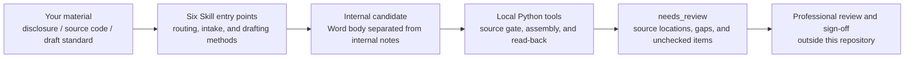

<!-- README_SYNC: source=working-tree; updated=2026-11-25 -->
<p align="center">
  <a href="./README.md">简体中文</a> · English
</p>

<div align="center">

# dyz-patent-copyright-skills

**Six Agent Skills and zero-dependency Python checks for patents, software copyrights, and technical standards. The Skills guide your AI assistant to verify source files and flag gaps before drafting, while local Python tools run bounded local checks (catching common condition flips, missing source links, and formatting leftovers) and assemble source-mapped Word drafts for professional review.**

If you have ever spent an evening fixing an AI draft that read smoothly until a reviewer spotted invented test numbers or inverted claim conditions, leave a [Star](https://github.com/duyunzhoudyz/dyz-patent-copyright-skills/stargazers) to bookmark the repo and help peers with the same headache find it.

[](CHANGELOG.md)
[](https://github.com/duyunzhoudyz/dyz-patent-copyright-skills/actions/workflows/ci.yml)
[](RELEASE.md)
[](https://github.com/duyunzhoudyz/dyz-patent-copyright-skills/commits/main)
[](LICENSE)

<p>
  <a href="#why-ordinary-ai-prompts-fail-on-real-filings">Why it exists</a> ·
  <a href="#what-each-of-the-six-skills-does">Six Skills</a> ·
  <a href="#see-it-work-right-away">See it work</a> ·
  <a href="#quick-start">Quick start</a> ·
  <a href="#what-it-will-not-do-and-what-has-been-verified">Limits &amp; verification</a> ·
  <a href="#architecture-and-technical-reference">CLI &amp; MCP</a> ·
  <a href="#license-and-commercial-authorization">License</a>
</p>

</div>

*(Note: the Skills, bundled fixtures, and linked docs are written in Chinese. This page is the English guide.)*

## Why ordinary AI prompts fail on real filings

General-purpose LLMs are eager to fill gaps and smooth out prose. On legal or technical-filing drafts, that habit quietly causes expensive mistakes:

- **Patent disclosures and claims:** Your source material says "confirmation is allowed only if the record has been written." While polishing, the model rewrites it to "once the record is written, confirmation is allowed." The wording looks close, yet a necessary condition just became a sufficient one, flipping claim scope. Worse, when an embodiment lacks test numbers, models routinely invent plausible temperatures or latencies to make a paragraph look complete.
- **Software-copyright filings:** Developers often hand a README to a chatbot and ask for an operation manual. The result invents UI screens that do not exist, mismatches software names or version numbers across forms, and comes back from examination with a deficiency notice.
- **Technical standards:** In standards drafting, "shall", "should", and "may" carry distinct normative weight. Models regularly soften mandatory clauses into recommendations, slip into circular definitions (defining A via B and B via A), or write unrun test claims as verified conformance.

### Why six Skills plus local Python tools instead of one long prompt

Long prompts rely on the model remembering every rule as a long chat grows. Once context fills up or you switch models, discipline slips.

This repository splits the work across two layers. **Six domain Skills provide step-by-step workflow guidance** for local file-capable AI hosts (such as Claude Code, Cursor, Codex, or Trae): check source scope first, ask only for missing facts that affect the draft, then draft by domain rules (workflow guidance keeps the model grounded, though it is not a 100% guarantee against model mistakes). **Zero-dependency Python standard-library tools** run bounded local checks over finite rule and syntax subsets: catching known condition-inversion patterns against the original filing, keeping Word body files and internal review notes in separate directories, stripping extra chunks from PNG screenshots, building source-line maps, and marking missing support explicitly as gaps.

| Common shortcut | With these Skills and local tools |
| --- | --- |
| One generic prompt handles patents, software copyright, and standards | Three separate professional tracks with six focused Skill entry points |
| Missing parameters or test results get quietly invented | Guides the model to draft from supplied files and list missing items as gaps, tracking unknown, unchecked, and not-applicable separately |
| Polishing patent prose flips a condition or drops support | Patent final-text gate 2.1 checks candidates against original filings and blocks known necessary/sufficient condition flips within its syntax subset |
| Software manuals are padded from marketing copy or a README | Facts come from an authorized source inventory with matched names, versions, real line counts, and actual UI/CLI behavior |
| Standards soften "shall" into "should" or slip in circular terms | The standards track independently checks clause strength, normative references, circular definitions, and verification evidence |
| Output dies inside a chat transcript mixed with reminders | Builds an editable Word body, vector figures, source-line map, and separate internal notes, then verifies them on read-back |

This repository fits engineers writing their first patent disclosure, indie developers preparing software-copyright paperwork, tech leads drafting enterprise or group standards, and patent attorneys or in-house IP teams who want traceable AI-assisted prep. It does not fit anyone looking for one-click, ready-to-file submissions or a replacement for licensed attorneys, examiners, or standards committees; every output stays an internal working draft awaiting human review.

## What each of the six Skills does

You do not need to run an entire pipeline or hand-author JSON first. Pick the Skill matching the task in front of you:

| What you need to get done | Skill entry point | How it saves rework |
| --- | --- | --- |
| Draft or review patent disclosures, claims, descriptions, or figures | [Patent (`dyz-patent`)](skills/dyz-patent/SKILL.md) | Extracts technical facts from code, design docs, or papers, asks targeted gap questions first, drafts claims and descriptions, and traces every limitation back to source lines |
| Triage an office action, check pre-publication disclosure risks and original-filing support, or map freedom-to-operate (FTO) / design-arounds | [Procedure & rights (`dyz-procedure`)](skills/dyz-procedure/SKILL.md) | Checks originals, versions, and urgent clues before drafting; breaks down office actions item by item against original filings to avoid added matter; separates infringement, freedom-to-operate (FTO), invalidity, and design-around tracks |
| Prepare software-copyright deposits, handle corrections, or track new versions | [Software copyright (`dyz-software`)](skills/dyz-software/SKILL.md) | Works from an authorized source list, separates original code from third-party libraries and secrets, aligns software names, versions, and line counts, and writes manuals strictly from real UI or CLI evidence |
| Draft enterprise, group, or national standards, dispose of comments, or build five-document submission packs (draft, explanatory notes, comment disposition, etc.) | [Technical standards (`dyz-standards`)](skills/dyz-standards/SKILL.md) | Organizes scope, terminology, clauses, and verification plans; checks "shall/should/may" strength, circular definitions, and references; links comment tables to clause edits and drafting notes |
| Export clean Word / PDF working packs or audit a manually edited Word file | [Rendering & review (`dyz-rendering`)](skills/dyz-rendering/SKILL.md) | Keeps external body documents and internal risk notes in separate directories, assembles review packs, and reads back edited DOCX files to list selected XML comment/tracked-change markers, verify controlled-marker bytes, and flag body-text/figure-list mismatches (confirming hidden-content removal, auto-numbering, and real-page visual layout still requires human review and page-by-page PDF inspection) |
| Run patents, copyright, and standards on one project, or resume after a break | [Shared workbench (`dyz-workbench`)](skills/dyz-workbench/SKILL.md) | Handles intake triage, material-permission checks, and version hand-overs so tracks can share verified facts without mixing their review statuses |

You can start narrow, such as checking units and figure numbers in one section or revising claim 1 against an original draft while listing every affected paragraph and figure. All six Skills share one `tools/` and `references/` tree, so keep the directory intact rather than copying a single `SKILL.md` out on its own.

## See it work right away

Both examples below were verified locally on `2026-11-25` on Windows with Python `3.14.6`, with zero third-party packages and zero network access.

### 1. Catching a silent claim-scope flip

Suppose your original filing reads: **"只有记录已写入，才允许确认。"** ("Confirmation is allowed only if the record has been written.") Writing the record is required, though other checks may still apply. If an AI editor rewrites it as **"一旦记录已写入，就允许确认。"** ("Once the record is written, confirmation is allowed."), the necessary condition flips into a sufficient one. Patent final-text gate 2.1 catches that shift against the original text:

| Source text | Candidate final text | Gate status | Why |
| --- | --- | --- | --- |
| 只有记录已写入，才允许确认。 (Confirmation is allowed only if the record has been written.) | 只有记录已写入，才允许确认。 (unchanged) | `checked` | Matches the original limiting relation |
| 只有记录已写入，才允许确认。 (Confirmation is allowed only if the record has been written.) | 一旦记录已写入，就允许确认。 (Once the record is written, confirmation is allowed.) | `blocked` | Necessary condition flipped into a sufficient condition |

Copy and run this pure-stdlib one-liner from the repository root to reproduce `ok: checked bad: blocked`:

```powershell
python -B -X utf8 -c "from tools import patent_gate; from tools.core import sha256_bytes; s='只有记录已写入，才允许确认。'; orig=[{'id':'O1','version':'1','role':'original','text':s,'sha256':sha256_bytes(s.encode())}]; print('ok:', patent_gate.audit_final_text({'claims':s}, orig)['status'], 'bad:', patent_gate.audit_final_text({'claims':'一旦记录已写入，就允许确认。'}, orig)['status'])"
```

A `blocked` status means the tool could not confirm source support; it is not a legal ruling. The gate covers a bounded syntax subset only (see [What it will not do, and what has been verified](#what-it-will-not-do-and-what-has-been-verified)).

### 2. Editable Word pack with body and internal notes in separate directories

Running Step 3 in [Quick start](#quick-start) builds a review pack from the repository's synthetic patent fixture and verifies it on read-back, generating seven files with external body text under `body/` and internal review notes under `internal/` so a human reviewer can inspect them separately before handover:

| File path | Role |
| --- | --- |
| `body/document.docx` | Editable Word body kept clean of internal reminders or risk notes |
| `body/GatewayFigures.svg` | Editable vector figures |
| `body/source.txt` | Body source text |
| `internal/source-map.json` | Paragraph-to-source line map for fast back-checking |
| `internal/notes.txt` | Internal drafting and review notes kept outside `body/` |
| `internal/quality-review.json` | Machine check results and unexecuted items |
| `manifest.json` | Pack inventory, hashes, and `needs_review` status |

Both previews below come from synthetic assets bundled with the repository and contain no real case or client data:

<table>
  <tr>
    <td width="42%" valign="top"></td>
    <td valign="top"></td>
  </tr>
  <tr>
    <td>Synthetic patent fixture figure (bundled with the repository)</td>
    <td>Synthetic software-copyright demo v1.3 screenshot (bundled with the repository)</td>
  </tr>
</table>

## Quick start

Runtime requirement: **Python 3.11 to 3.14 standard library**, with zero `pip` dependencies for core tools. Clone the repository or unpack a verified local bundle while keeping `tools/`, `skills/`, and `references/` in place. For full playbooks covering patents, software copyright, standards, and MCP setup, see [quickstarts.md](skills/dyz-workbench/resources/quickstarts.md).

### Option A: point your AI assistant straight at a Skill (no JSON needed)

The local Python tools stay offline by default, but if your host calls a cloud model, any file you feed in still passes through that model provider. Check your confidentiality rules before loading unpublished inventions or client source code; to try it without loading private material, start with the bundled public synthetic fixture [cn-gateway-example.md](skills/dyz-patent/resources/cn-gateway-example.md) (your host still controls what leaves your machine).

Open this repository in a local file-capable host (Claude Code, Cursor, Codex, or Trae) and point it at the Skill for your task, for example:

> "Read `skills/dyz-patent/SKILL.md` first. Draft an internal patent disclosure strictly from Section 0.1 of `skills/dyz-patent/resources/cn-gateway-example.md`; cite the source paragraph ID for every technical fact, leave missing numbers blank, and list every gap instead of inventing parameters."

That prompt asks the assistant for two outputs: an internal working draft with source paragraph IDs attached to each fact, and an explicit gap list showing which parameters, test data, or background details are missing (always check the output against the source yourself).

### Option B: run the local tools, Word pack, and MCP preview in 4 steps

**Step 1: check Python and inspect the 83-capability catalog**

```powershell
python --version
python -B -X utf8 -m tools help
python -B -X utf8 -m tools list
```

`python --version` should report `3.11.x` through `3.14.x`. `help` lists every CLI subcommand (run `python -B -X utf8 -m tools help <topic>` for argument details), and `list` prints the 83-entry `synthetic_helper_only` catalog JSON across 11 domains.

**Step 2: run the built-in synthetic rehearsal and confirm offline defaults**

```powershell
python -B -X utf8 -m tools demo --synthetic --root . --output synthetic-demo.json
python -B -X utf8 -m tools connector-status
```

`demo` writes `synthetic-demo.json` under the root directory and prints `result_written`. `connector-status` prints `status: "offline_by_default"` with `network_requests: 0`.

**Step 3: build and read back a synthetic Word review pack**

```powershell
python -B -X utf8 -m tools.documents --synthetic --root . --input skills/dyz-rendering/resources/document-example.json --output patent-review-pack
python -B -X utf8 -m tools.documents --synthetic --root . --input skills/dyz-rendering/resources/document-example.json --output patent-review-pack --verify
```

These commands print `document_written_needs_review` and `document_verified_needs_review`. The output directory must not exist beforehand and must stay under `--root` (it is ignored by Git in the repo root). Optional PDF export requires a local LibreOffice install and is not needed for a first run.

**Step 4: preview a local host installation plan and MCP (`stdio`) snippet**

```powershell
python -B -X utf8 -m tools.install --target ./dyz-installed-preview --host claude-code --plan
python -B -X utf8 -m tools.mcp_server --print-config --host claude-code
```

Both commands print to stdout only: **nothing is written to disk and global host settings stay untouched**. Both accept `claude-code`, `cursor`, `codex`, `trae`, and `generic` for `--host`; `tools.mcp_server --print-config --host codex` outputs TOML, while the other hosts and `tools.install --plan` output JSON.

## What it will not do, and what has been verified

This release is **`0.1.1`** (`main` branch, tag `v0.1.1`, released `2026-11-25`). All 83 catalog entries across 11 capability domains remain `synthetic_helper_only`: structured drafting workflows, synthetic fixtures, and bounded local checks. Release scope, verified baselines, and maintainer metadata live in [RELEASE.md](RELEASE.md), [release.json](release.json), and [CHANGELOG.md](CHANGELOG.md).

### Verified baseline vs unexecuted checks

| Area | Status | Exact scope |
| --- | --- | --- |
| Cross-platform local baseline | Verified (12 / 12 green) | `verified_platforms` and `supported_platforms` in `release.json` are aligned to Windows / Linux (Ubuntu) / macOS × Python `3.11 / 3.12 / 3.13 / 3.14` (pure-stdlib local tools and automated unit tests). Specifically, merged state `main@697d8a2` passed all **`2,145 / 2,145`** repository unit tests (0 failures, 0 errors, 0 skips), `compileall`, `validate_readme_pair.py`, and `evals/release_check.py --publication` locally on Windows (Python `3.14.6`), building on the prior local Windows Python `3.11 / 3.12 / 3.13 / 3.14` baseline. On `2026-11-25`, the same commit passed **12 / 12** jobs on hosted GitHub Actions ([run 45592934144](https://github.com/duyunzhoudyz/dyz-patent-copyright-skills/actions/runs/45592934144)) across `windows-latest`, `ubuntu-latest`, and `macos-latest` × Python `3.11 / 3.12 / 3.13 / 3.14` (running `release_check.py`, `compileall`, and the full local test suite, with 4 expected platform skips on Linux/macOS: 2 Windows junction tests, 1 Windows case-collision test, and 1 optional external PDF tool test). The full suite will be re-run before merging `v0.1.1`; check [GitHub Actions](https://github.com/duyunzhoudyz/dyz-patent-copyright-skills/actions/workflows/ci.yml) for the latest run status. |
| Explicitly unexecuted | Not performed | Live outbound requests (`tools/connectors/` stays offline by default and permits read-only requests only under explicit disclosure approval binding host, purpose, normalized query, pagination scope, and expiry plus hard budget caps; no live network requests have been run locally), cross-platform Office / LibreOffice / Poppler visual page and pagination checks, blind human evaluations on paid models (`evals/benchmark_harness.py` is fixture-checked offline only), and licensed practitioner sign-off. |

### Hard limits

- **Tool checks are not professional sign-off:** A `checked` status, zero issues, a clean Word build, or matching PDF text only reflects bounded local checks. Every output stays an internal draft; licensed patent attorneys, legal counsel, software-copyright examiners, and standards organizations remain responsible for substantive judgment and official approval.
- **Patent gate 2.1 and US/EP analyzers cover finite rule subsets:** Dependent-claim inheritance, structural anchors, finite English conditional patterns, dual-track office-action checks, and US/EP formal cues are not full legal examination or equivalence analysis. When `blocked` fires, keep the original filing and hand over an internal draft marked incomplete for human review.
- **Offline by default, no real-world filing actions, and no OS sandbox:** Optional connectors (`tools/connectors/`) stay offline by default and allow read-only calls only with explicit disclosure approval and hard budget caps. None of the tools file applications, send outbound submissions, sign documents, or process payments.
- **Offline Python tools do not make a cloud model offline:** If your host sends prompts to a remote model, supplied files still cross that host's data path. Confirm your confidentiality rules before loading unpublished inventions, client source code, or restricted standards.
- **Synthetic entry points accept synthetic fixtures only:** Never relabel real case files as synthetic to bypass gates; use the authorized local entry points for real software and standards material.
- **Host discovery and cross-platform layout require local verification:** `tools/mcp_server.py` and `tools/install.py` never touch global host configs. Multi-turn model behavior and Linux/macOS LibreOffice/Poppler pagination need verification in your own environment.

## Architecture and technical reference



One project can reuse authorized evidence across tracks, while statuses, versions, disclosure scopes, and deliverables stay separate. Instructions inside a Skill are not technical isolation; see [cross-subsystem hand-over and disclosure approval](docs/disclosure-and-handoff.md).

| Subsystem / layer | Owns | Does not replace |
| --- | --- | --- |
| Patent | Search strategy, disclosures, patentable space, claims, descriptions and figures, review, office-action responses, infringement/FTO, and portfolio tracking | Software-copyright registration decisions, standards consensus, or publication approval |
| Software copyright | Ownership and versions, actual source code and manuals, deposit materials, corrections, changes, and dispute evidence | Patentability, claim scope, or non-infringement conclusions |
| Technical standards | System studies, proposals, terminology and clauses, verification evidence, comment handling, international adoption, submission hand-over, and revision | Patent essentiality determinations, committee approval, or product certification |
| Shared base layer | Evidence records, permissions, terminology and versions, diffs, drawing and export, review logs, and evaluation runs | Any professional judgment; rules, pass criteria, and sign-off belong to each domain |

### MCP server, local installer, and `HostToolBridge` 10-tool boundary

| Module | Behavior and constraints |
| --- | --- |
| `tools/mcp_server.py` | Pure-stdlib JSON-RPC 2.0 `stdio` server handling both `Content-Length` framing and NDJSON. **Refuses to start bare:** pass `--catalog-only` explicitly to expose only the read-only `dyz_catalog` tool, or bind a verified runtime bundle, workspace, control directory, and out-of-band manifest hash (`--package`, `--workspace`, `--control`, `--manifest-sha256`) to expose the 10 `HostToolBridge` tools. Run `python -B -X utf8 -m tools.mcp_server --describe` to inspect all 11 tool definitions. |
| `HostToolBridge` 10 tools | `case_read`, `case_write`, `case_info`, `case_copy`, `case_image`, `case_documents`, `case_docx_review`, `case_fidelity`, `case_standard_package`, and `case_software`. Starting `tools/mcp_server.py` in bound-bundle mode or running `tools.host_bridge` via CLI **requires** `--manifest-sha256`, and constructing `HostToolBridge` in Python for a standalone runtime bundle **requires** `expected_manifest_sha256` (unlike `tools.bundle --verify` without a hash, which checks internal consistency only); at runtime, package scope is read-only for manifest-listed files and `bundle-manifest.json` checked against loaded hashes; workspace reads stay within `input/`, `work/`, and `output/` with writes limited to `work/` and `output/`, guarded against path escape and symlink/reparse tricks. See [host-bridge.md](skills/dyz-workbench/resources/host-bridge.md). |
| `tools/install.py` | Cross-platform local installer and tamper verifier supporting `--plan` dry runs without writing to disk, isolated 309-file bundle installs with host index and MCP snippets, and `--verify` against out-of-band hashes. Never edits global host settings. |

<details>
<summary>Expand all 26 CLI subcommands and domain engineering modules</summary>

Run `python -B -X utf8 -m tools help` for all subcommands, or `python -B -X utf8 -m tools help <topic>` for argument details on a specific command.

| Group | Subcommands | Purpose and limits |
| --- | --- | --- |
| Exploration & synthetic runs | `help`, `list`, `demo`, `run`, `preview` | Top-level and per-topic help, 83-item catalog, built-in disclosure rehearsal, single-capability synthetic runs, static HTML previews |
| Patent & strategy checks | `check-patent-ir`, `build-patent-pack`, `verify-patent-pack`, `check-jurisdiction`, `check-strategy` | Claim-fact IR and draft skeleton, synthetic patent pack build and external summary SHA-256 read-back, bounded US/EP claim checks, no-go / FTO / SEP strategy tracks |
| Visual, template & governance | `check-visual-ledger`, `check-capture-manifest`, `inspect-template`, `check-trial-upgrade`, `connector-status` | Page-observation ledger, capture manifest and cleaned PNG checks, read-only DOCX/DOTX template safety inspection, 3-consecutive-case trial gate checks (never auto-upgrades support level), default-offline connector status |
| Authorized software pipeline | `software-intake`, `discover-software`, `prepare-software`, `import-software-manual`, `build-software`, `export-software`, `software-batch` | Batched intake, authorized candidate discovery, local prep, manual revision import, DOCX/PDF builds, isolated batch status index; no automatic outbound sending |
| Technical standards pipeline | `standard-intake`, `prepare-standard`, `migrate-standard-comments`, `standard-pdf` | Five-document v2 intake, generation and read-back, explicit comment-table migration, authorized PDF export with per-page evidence |

Additional domain modules and docs: patent gate 2.1 (`tools/patent_gate.py`), native Word OMML equations (`tools/omml.py`), default-offline connector policy adapters (`tools/connectors/`), [authorized software material pipeline](skills/dyz-software/resources/tools.md#软件成品链与集中采集), [standards five-document loop and v3 layout](skills/dyz-standards/resources/tools.md#五文书闭环与本地入口), [document assembly](skills/dyz-rendering/resources/tools.md), [edited Word read-back](skills/dyz-rendering/resources/docx-readback.md), and the [limited public patent-search appendix](skills/dyz-patent/resources/cn-gateway-search.md).

</details>

### Source repository (415 files) vs complete local bundle (309 source files)

The repository separates development files from the fixed runtime whitelist delivered to end users:

| Scope | File count | Included | Excluded |
| --- | --- | --- | --- |
| Git source repository | `source_candidates: 415` | Six Skills and runtime assets, `tools/`, authorized `references/`, whitelisted design docs, `evals/` tests and fixtures, `.github/` CI workflow, `README_EN.md`, license and release metadata | Local work logs, competitor snapshots, historical model transcripts, `outputs/`, `tmp/`, local editor config, and private cases |
| Complete local runtime bundle | `bundle_source_files: 309` | Six entry points, shared `tools/`, runtime assets, whitelisted docs, and license files, plus `bundle-manifest.json` | Development tests, synthetic test fixtures, CI definitions, and release checkers (these development materials are not distributed with the local bundle); `README_EN.md` ships with the source repository only and is not on the bundle whitelist |

To deliver only runtime files, build from the fixed whitelist and verify against an out-of-band manifest SHA-256 (the destination must not exist and its parent directory must exist):

```powershell
python -B -X utf8 -m tools.bundle --destination D:/dyz-local-bundle
$dyzManifestSha = (Get-FileHash -LiteralPath D:/dyz-local-bundle/bundle-manifest.json -Algorithm SHA256).Hash.ToLowerInvariant()
python -B -X utf8 -m tools.bundle --verify D:/dyz-local-bundle --manifest-sha256 $dyzManifestSha
```

Building prints `bundle_created`, and verification returns JSON with `"status": "matched"`. Store the manifest hash outside the bundle and verify downloads against the publisher's hash instead of recomputing an expected value from an untrusted copy. Internal consistency alone does not authenticate origin, licensing, or professional quality. See [package-use.md](skills/dyz-workbench/resources/package-use.md) for layout, on-demand loading, freezing, and recovery details.

`.gitignore` whitelists the repo root and `docs/`, and `.gitattributes` turns off line-ending conversion to keep exact byte bindings for source maps and fixtures. Never commit client source code, unfiled disclosures, IDs, seal files, or restricted standards; store private cases in a separate directory or the ignored `private/` directory. Git ignore rules are neither encryption nor access control, so check tracked files before pushing.

## How it relates to similar skills

Several public skills handle individual parts of these workflows well. The table below reflects a static reading of fixed commits taken on `2026-11-02`; none of the upstream projects were benchmarked side by side, and this is not a ranking:

| Track | Representative projects (fixed commits) | Worth studying from source inspection | Emphasis in this repository |
| --- | --- | --- | --- |
| Patent | [paper2patent](https://github.com/7toCR/paper2patent/tree/53d0a2d2cbd8db6de824dfed86aab1763caa7142), [patent-disclosure-skill](https://github.com/handsomestWei/patent-disclosure-skill/tree/0b95b547f78c2a0dd0e4e71eb43a88841c99c936) | Chaining claims, figures, DOCX/PDF export, and separate drafting notes; clear multi-task routing | Source-support chains, reference-by-reference comparison, change-impact tracking, and procedural hand-over |
| Software copyright | [SoftwareCopyright-Skill](https://github.com/Fokkyp/SoftwareCopyright-Skill/tree/1159f6d280783616e1247f768690eac97c1a3f6e), [software-certificate-skill](https://github.com/IvanCodesDev/software-certificate-skill/tree/ee7d4636f35210767adc0b5689f8678c68e6f7e6) | Chaining source selection and document assembly; real UI screenshots and partial rebuilds after edits | Separating expression, rights, and licenses; same-version fact checks and version invalidation |
| Technical standards | [gbt-standard-docx-skill](https://github.com/zhangzhangco/gbt-standard-docx-skill/tree/a3af82bc790b0dcf9c2eb8c7123df46311da68da) | DOCX templates, cross-references, and comment-disposition workflows | Linking clauses to verification evidence, comment-impact tracking, and pre-publication IP hand-over |

We do not treat local test counts, repository stars, or spec length as claims of superiority, and no upstream implementation code has been imported. Full static notes live in [docs/github-skill-comparison-20261102.md](docs/github-skill-comparison-20261102.md) and [docs/github-skill-comparison-20261102-sources.json](docs/github-skill-comparison-20261102-sources.json), with license and reuse boundaries in [THIRD-PARTY-NOTICES.md](THIRD-PARTY-NOTICES.md).

## Documentation, contributing, and security

<details>
<summary>Expand the 6 core design documents</summary>

- [Global capability blueprint](docs/capability-blueprint.md): 11 domains, 83 top-level capability IDs, three-track ownership, and adaptation boundaries.
- [Capability contracts and coverage matrix](docs/capability-contracts.md): inputs, outputs, responsibilities, and acceptance criteria (spec coverage is not implementation completion).
- [Cross-subsystem hand-over and disclosure approval](docs/disclosure-and-handoff.md): permissions, versions, sign-off, outbound controls, and incident handling.
- [Roadmap and quality gates](docs/roadmap-and-quality.md): long-term targets, dependencies, and verification limits (a plan is not current support).
- [Project development standards](docs/development-standards.md): conventions for directories, skills, rules, code, and layered verification.
- [Reference-project source analysis](docs/reference-analysis.md): fixed-version sources, licenses, and reuse boundaries.

</details>

Issues and pull requests improving methods, documentation, synthetic fixtures, and local tools are welcome; see [CONTRIBUTING.md](CONTRIBUTING.md). Original contributions intended for merge require explicit contributor agreement to [CONTRIBUTOR-LICENSE.md](CONTRIBUTOR-LICENSE.md) (contributors keep copyright while granting **杭州溥源智能科技有限公司**, named in [release.json](release.json), the rights required for commercial relicensing) plus `Signed-off-by`. Unconfirmed patches are discussed and reviewed only and are not merged beforehand.

Before opening a pull request, run the three checks configured in `.github/workflows/ci.yml` from the source root (the full suite takes a few minutes):

```powershell
python -B -X utf8 evals/release_check.py
python -B -X utf8 -m unittest discover -s evals -q
python -B -X utf8 -m compileall -q tools evals skills
```

Report sensitive security issues privately following [SECURITY.md](SECURITY.md). The `security_contact` field in [release.json](release.json) is `AI4anyone(wechat)`. On first contact, verify maintainer identity and confirm the receiving channel before sending only sanitized minimal details; never post exploit payloads, client files, unpublished inventions, or credentials in public issues or pull requests.

## License and commercial authorization

Original content in this repository is **Source Available** under the [PolyForm Noncommercial License 1.0.0](LICENSE) with separate commercial licensing.

Subject to the notice-preservation conditions in [LICENSE](LICENSE), permitted purposes cover noncommercial purposes, personal uses without anticipated commercial application (including personal research, experiment, and testing for the benefit of public knowledge, plus personal study and hobby projects), and use by noncommercial organizations expressly named in the license (charitable organizations, educational institutions, public research organizations, public safety or health organizations, environmental protection organizations, and government institutions) regardless of the source of funding or obligations resulting from the funding (commercial entities themselves still require separate commercial authorization). The full text of [LICENSE](LICENSE) governs and is not narrowed by this summary.

Being an individual does not by itself make commercial use free. Any commercial use outside what [LICENSE](LICENSE) allows (including internal company R&D or IP workflows, paid client work at law firms or patent agencies, commercial SaaS integration, or commercial redistribution) requires prior written commercial authorization; see [COMMERCIAL-LICENSE.md](COMMERCIAL-LICENSE.md) for common scenarios. Third-party research materials and limited EPO public data stay under their original licenses; see [THIRD-PARTY-NOTICES.md](THIRD-PARTY-NOTICES.md).

Original content is held and commercially licensed by **杭州溥源智能科技有限公司**, with commercial inquiries directed to `402784717@qq.com` (matching [release.json](release.json) and [RELEASE.md](RELEASE.md)). Source availability, downloads, inquiries, or reading these notes do not grant a commercial license.

---

If this saves you a round of rework on a patent disclosure, software-copyright deposit, or standards draft, leave a [Star](https://github.com/duyunzhoudyz/dyz-patent-copyright-skills/stargazers) so it is easy to find next time. Hit a bug or an edge case? Open an [issue](https://github.com/duyunzhoudyz/dyz-patent-copyright-skills/issues) or send a pull request via [CONTRIBUTING.md](CONTRIBUTING.md).
