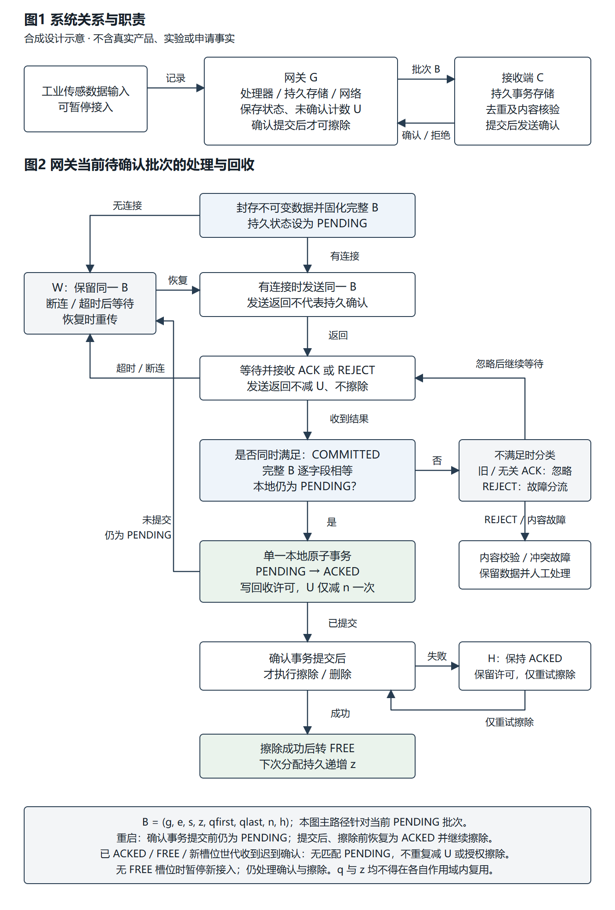
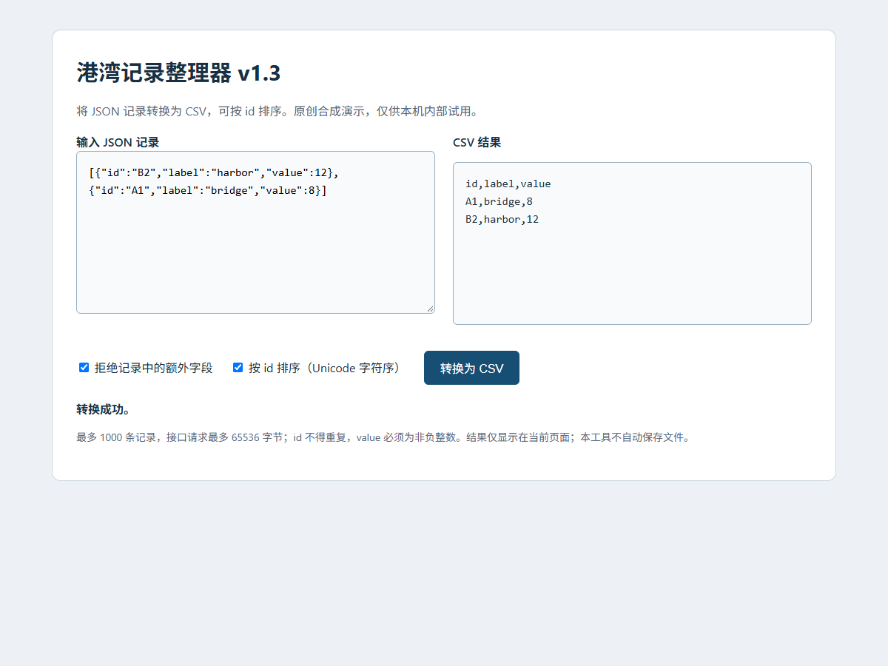
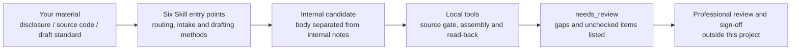

<!-- README_SYNC: source=working-tree; updated=2026-11-25 -->
<p align="center">
  <a href="./README.md">简体中文</a> · English
</p>

<div align="center">

# dyz-patent-copyright-skills

**Agent Skills and pure-stdlib local tools for patent attorneys, in-house IP/R&D teams, software-copyright preparers and technical-standards drafters: the model drafts and checks strictly against supplied material, lists source support and gaps item by item, and every output stays an internal candidate awaiting professional review.**

If this traceable workflow is useful to you, add a [Star](https://github.com/duyunzhoudyz/dyz-patent-copyright-skills/stargazers) to bookmark the repository and help practitioners with the same problem find it.

[](https://github.com/duyunzhoudyz/dyz-patent-copyright-skills/stargazers)
[](https://github.com/duyunzhoudyz/dyz-patent-copyright-skills/actions/workflows/ci.yml)
[](https://github.com/duyunzhoudyz/dyz-patent-copyright-skills/issues)
[](CHANGELOG.md)
[](RELEASE.md)
[](RELEASE.md)
[](RELEASE.md)
[](LICENSE)

[](https://github.com/duyunzhoudyz/dyz-patent-copyright-skills/stargazers)

<p>
  <a href="#quick-start">Quick start</a> ·
  <a href="#reproducible-examples">Examples</a> ·
  <a href="#pick-a-skill-entry-point">Six Skills</a> ·
  <a href="#local-cli-and-mcp-tools">CLI &amp; MCP</a> ·
  <a href="#verification-status-and-limits">Verification &amp; limits</a> ·
  <a href="#how-it-relates-to-similar-skills">Similar skills</a>
</p>

</div>

> **Release status and maturity boundary:** `0.1.0` is the first formal release on the `main` branch (release tag `v0.1.0`, released `2026-11-25`). All 83 catalog entries across 11 capability domains remain `synthetic_helper_only`: structured drafting methods, synthetic fixtures and bounded local tools are available, which do not represent complete professional capability, legal opinions, practitioner substitution or official approval. Release scope, verified baselines and maintainer metadata are recorded in [RELEASE.md](RELEASE.md) and [release.json](release.json); changes are in [CHANGELOG.md](CHANGELOG.md).
>
> **Language:** The skills, resources and linked documents are written in Chinese. This file is the English entry point.

## What problem it addresses

When a language model drafts a patent specification, software-copyright filing material or a standard clause directly, the prose usually reads smoothly while hiding consequential edits: an invented parameter, "only if" turned into "once", "shall" softened into "should", or an unsearched question reported as "none found". The sentences look similar on the surface, yet claim scope, registered facts or normative requirement strength has already shifted.

| Common practice | How this repository handles it |
| --- | --- |
| One general prompt covers patents, software copyright and standards | Three professional tracks judge independently while sharing evidence, versions and local tools through six Skill entry points |
| The model fills in missing parameters, test results or citations | Drafting stays within supplied material; missing items become explicit gaps, with unknown, unchecked and not-applicable recorded separately |
| Polishing patent text flips a limitation or drops source basis | The patent track checks technical schemes, claim scope and original support independently; patent final-text gate 2.1 compares candidates against source text and blocks inverted necessary/sufficient conditions |
| Drafting or revising standards softens requirement strength or introduces circular definitions | The standards track checks normative requirement strength ("shall"/"should"/"may"), references and circular definitions independently, without mixing in patent rules or replacing testing and committee approval |
| Output stays inside a chat transcript | Produces an editable Word document, figures, a source-line map and separate internal notes that can be read back and verified |
| A script finishes and reports "passed" | Outputs stay marked `needs_review`, skipped or unexecuted checks are recorded as `not_performed`, and professional sign-off stays separate |

**Good fit:** Patent attorneys, in-house IP and R&D teams, software-copyright preparers and technical-standards drafters who already use a local file-capable agent host (such as Claude Code, Cursor, Codex or Trae) and want traceable internal working drafts.

**Not a fit:** Teams expecting one-click, ready-to-file submissions, or looking to replace the judgment of licensed practitioners, legal counsel or standards bodies.

## Reproducible examples

Both examples below were verified locally on 2026-11-25 on Windows with Python 3.14.6, with zero external packages and zero network access.

### Example 1: patent final-text gate catching condition inversion

Before a patent candidate is handed over, the gate compares it against the original application text. Both rows below use the same Chinese source sentence:

| Source text | Candidate final text | Gate status | Why |
| --- | --- | --- | --- |
| 只有记录已写入，才允许确认。 (Confirmation is allowed only if the record has been written.) | 只有记录已写入，才允许确认。 (unchanged) | `checked` | Matches the source limiting relation |
| 只有记录已写入，才允许确认。 (Confirmation is allowed only if the record has been written.) | 一旦记录已写入，就允许确认。 (Once the record is written, confirmation is allowed.) | `blocked` | Necessary condition flipped into a sufficient condition |

Run this pure-stdlib one-liner from the repository root to reproduce it directly (expected output: `ok: checked bad: blocked`):

```powershell
python -B -X utf8 -c "from tools import patent_gate; from tools.core import sha256_bytes; s='只有记录已写入，才允许确认。'; orig=[{'id':'O1','version':'1','role':'original','text':s,'sha256':sha256_bytes(s.encode())}]; print('ok:', patent_gate.audit_final_text({'claims':s}, orig)['status'], 'bad:', patent_gate.audit_final_text({'claims':'一旦记录已写入，就允许确认。'}, orig)['status'])"
```

`blocked` means the gate could not confirm support in the source text; it is not a legal determination. The gate covers a finite syntax subset only; see [What this release does not do](#what-this-release-does-not-do).

### Example 2: closed Word review pack separating body and internal notes

Step 3 of [Quick start](#quick-start) assembles a review pack from the repository's synthetic patent fixture and verifies it on read-back, generating seven files:

| File path | Role |
| --- | --- |
| `body/document.docx` | Editable Word body kept clean of internal notes |
| `body/GatewayFigures.svg` | Editable vector figures |
| `body/source.txt` | Body source text |
| `internal/source-map.json` | Paragraph-to-source line mapping |
| `internal/notes.txt` | Internal drafting and review notes kept outside `body/` |
| `internal/quality-review.json` | Quality checks and unexecuted items record |
| `manifest.json` | Pack inventory, hashes and review status |

<table>
  <tr>
    <td width="42%" valign="top"></td>
    <td valign="top"></td>
  </tr>
  <tr>
    <td>Synthetic patent fixture figure (shipped with the repository)</td>
    <td>Synthetic software-copyright demo v1.3 screenshot (shipped with the repository)</td>
  </tr>
</table>

Both images are synthetic example assets bundled with the repository and contain no real case or client material.

## Quick start

Runtime requirement: **Python 3.11 to 3.14 standard library**, with zero mandatory pip dependencies. Clone the complete source tree or unpack a verified complete local bundle, keep `tools/`, `skills/` and `references/` in their relative layout, and run commands from the root directory. Full 3-minute playbooks across patents, software copyright, standards and MCP setup are in [quickstarts.md](skills/dyz-workbench/resources/quickstarts.md).

### Step 1: check Python and inspect the 83-capability catalog

```powershell
python --version
python -B -X utf8 -m tools help
python -B -X utf8 -m tools list
```

`python --version` should report `3.11.x` through `3.14.x`. `help` prints all available CLI subcommands, and `list` prints the 83-entry `synthetic_helper_only` JSON catalog across 11 domains.

### Step 2: run the built-in synthetic rehearsal and offline connector check

```powershell
python -B -X utf8 -m tools demo --synthetic --root . --output synthetic-demo.json
python -B -X utf8 -m tools connector-status
```

`demo` writes `synthetic-demo.json` under the root directory and prints `result_written`. `connector-status` prints `status: "offline_by_default"` with `network_requests: 0`.

### Step 3: build and read back a synthetic Word review pack

```powershell
python -B -X utf8 -m tools.documents --synthetic --root . --input skills/dyz-rendering/resources/document-example.json --output patent-review-pack
python -B -X utf8 -m tools.documents --synthetic --root . --input skills/dyz-rendering/resources/document-example.json --output patent-review-pack --verify
```

The two commands print `document_written_needs_review` and `document_verified_needs_review`. The output path must not exist beforehand and must stay under `--root` (in the repository root it is ignored by Git). PDF conversion is an explicit optional step requiring a local LibreOffice installation and is not needed for initial evaluation.

### Step 4: preview a local host installation plan and MCP config snippet

The two commands below print a JSON dry-run installation plan and an MCP (`stdio`) client configuration snippet to stdout. They **do not write to disk and never modify global host configuration**. Both commands accept `claude-code`, `cursor`, `codex`, `trae` and `generic` for `--host`; `tools.mcp_server --print-config --host codex` prints a TOML snippet, while the other hosts and `tools.install --plan` print JSON.

```powershell
python -B -X utf8 -m tools.install --target ./dyz-installed-preview --host claude-code --plan
python -B -X utf8 -m tools.mcp_server --print-config --host claude-code
```

For plain-text drafting or review, you can also point any local file-capable agent straight at `skills/dyz-patent/SKILL.md` (or another track below) and ask for an internal working draft grounded strictly in your supplied material, without writing JSON first.

## Pick a Skill entry point

| Task | Skill entry point | Internal candidates produced |
| --- | --- | --- |
| Draft or revise patent text from technical material | [Patent](skills/dyz-patent/SKILL.md) | Technical facts, comparison against supplied references, claims and description, figures, support back-check |
| Handle office actions, responses, protection strategy and rights | [Procedure and rights](skills/dyz-procedure/SKILL.md) | Notice triage, response and replacement text, support and procedural impact, strategy hand-over |
| Prepare software-copyright filing or dispute material | [Software copyright](skills/dyz-software/SKILL.md) | Scope and contributions, source selection, user and design manuals, same-version fields and missing items |
| Draft or revise technical standards | [Technical standards](skills/dyz-standards/SKILL.md) | Scope, terms, normative clauses, verification plan, drafting notes, comment disposition and revision impact |
| Verify final documents or diagnose export defects | [Rendering and review](skills/dyz-rendering/SKILL.md) | Source-to-output verification, separation of body and internal notes, display and print check records |
| Resume a project or route across tracks | [Shared workbench](skills/dyz-workbench/SKILL.md) | Known facts, version dependencies, open questions and hand-over notes for receiving roles |

You can start with a narrow task such as fixing one item against an original draft and listing every affected paragraph and figure. All six skills share one `tools/` and `references/` directory tree; do not copy a single Skill folder out as a standalone install.

## Local CLI and MCP tools

### CLI subcommands (`python -B -X utf8 -m tools <subcommand>`)

| Group | Subcommands | Purpose and limits |
| --- | --- | --- |
| Exploration and synthetic runs | `help`, `list`, `demo`, `run`, `preview` | CLI help, 83-item catalog, built-in disclosure rehearsal, single-capability synthetic runs and static HTML snapshot previews |
| Patent and strategy checks (new) | `check-patent-ir`, `build-patent-pack`, `verify-patent-pack`, `check-jurisdiction`, `check-strategy` | Claim-fact IR validation and draft skeleton, synthetic patent pack build and external summary SHA-256 read-back, bounded US/EP claim checks, and no-go / FTO / SEP strategy tracks |
| Visual, template and governance checks (new) | `check-visual-ledger`, `check-capture-manifest`, `inspect-template`, `check-trial-upgrade`, `connector-status` | Page-observation coverage ledger, capture manifest and cleaned PNG validation, read-only DOCX/DOTX template safety inspection, 3-consecutive-case trial gate checks (never auto-upgrades support level) and default-offline connector status |
| Authorized local software pipeline | `software-intake`, `discover-software`, `prepare-software`, `import-software-manual`, `build-software`, `export-software`, `software-batch` | Batched intake, authorized candidate discovery, local preparation, manual revision import, DOCX/PDF builds and isolated batch index; no automatic outbound sending |
| Technical standards pipeline | `standard-intake`, `prepare-standard`, `migrate-standard-comments`, `standard-pdf` | Five-document v2 intake, generation and verification, explicit comment-table migration, and authorized PDF conversion with per-page evidence |

Run `python -B -X utf8 -m tools help` for top-level command usage, or `python -B -X utf8 -m tools help <topic>` for argument help on a specific subcommand.

### Standard MCP server, local installer and `HostToolBridge` 10-tool contract

| Module / area | Details and entry points |
| --- | --- |
| `tools/mcp_server.py` | Pure-stdlib JSON-RPC 2.0 `stdio` server supporting both `Content-Length` framing and NDJSON. It refuses to start bare: pass `--catalog-only` explicitly to expose only the read-only `dyz_catalog` tool, or bind a verified runtime bundle, workspace, control directory and out-of-band manifest hash (`--package`, `--workspace`, `--control`, `--manifest-sha256`) to expose the 10 `HostToolBridge` tools. Run `python -B -X utf8 -m tools.mcp_server --describe` to inspect all 11 tool schemas. |
| `HostToolBridge` 10 tools | `case_read`, `case_write`, `case_info`, `case_copy`, `case_image`, `case_documents`, `case_docx_review`, `case_fidelity`, `case_standard_package`, `case_software`. Startup verifies the bundle manifest and, when supplied, an out-of-band manifest hash; at runtime, package scope is read-only for manifest-listed files and `bundle-manifest.json` checked against loaded hashes; workspace reads stay inside `input/`, `work/` and `output/` with writes limited to `work/` and `output/`, subject to path-boundary and symlink/reparse checks; see [host-bridge.md](skills/dyz-workbench/resources/host-bridge.md). |
| `tools/install.py` | Cross-platform local installer and tamper verifier supporting `--plan` dry runs, isolated 309-file bundle installs with `skills-manifest.json` and host MCP snippets, and `--verify` against out-of-band hashes without modifying global host configuration. |
| Domain tools and resources | Patent gate 2.1 (`tools/patent_gate.py`), native Word OMML equations (`tools/omml.py`), default-offline connector policy adapters (`tools/connectors/`), [authorized software material pipeline](skills/dyz-software/resources/tools.md#软件成品链与集中采集), [standards five-document loop and v3 layout](skills/dyz-standards/resources/tools.md#五文书闭环与本地入口), [document assembly](skills/dyz-rendering/resources/tools.md), [edited Word read-back](skills/dyz-rendering/resources/docx-readback.md) and the [limited public patent-search appendix](skills/dyz-patent/resources/cn-gateway-search.md). |

## Architecture and domain boundaries



| Subsystem / layer | Owns | Does not replace |
| --- | --- | --- |
| Patent | Search, disclosures, patentable space, claims, descriptions and figures, review, office-action responses, infringement/FTO and portfolio work | Software-copyright registration decisions, standards consensus or publication approval |
| Software copyright | Ownership and versions, actual source code and manuals, deposit and registration materials, corrections, changes and dispute evidence | Patentability, claim scope or non-infringement conclusions |
| Technical standards | System studies, proposals, terminology and clauses, verification basis, comment handling, international adoption, submission hand-over and revision | Patent essentiality determinations, committee approval or product certification |
| Shared base layer | Evidence records, permissions, terminology and versions, diffs, drawing and export, review logs and evaluation runs | Any professional judgment; domain rules, pass criteria and sign-off stay with each professional subsystem |

One project can reuse authorized evidence across tracks, while statuses, versions, disclosure scopes and deliverables remain independent. Prompt instructions inside a Skill are not technical isolation; see [cross-subsystem hand-over and disclosure approval](docs/disclosure-and-handoff.md).

## Verification status and limits

### Current baseline vs unexecuted checks

| Dimension | Status | Exact scope |
| --- | --- | --- |
| Verified local Windows baseline | Verified locally | `release.json` declares Windows with Python `3.11 / 3.12 / 3.13 / 3.14` as the locally verified baseline (`verified_platforms: ["Windows"]`, `verified_python: ["3.11", "3.12", "3.13", "3.14"]`), matching `RELEASE.md`, `quickstarts.md` and `package-use.md`. Across the prior four-version Windows baseline (Python `3.11.15 / 3.12.13 / 3.13.14 / 3.14.6`), all `2,139` unit tests, `compileall` and `evals/release_check.py` passed; the full suite is re-run on the final merged release commit before tagging, so final totals follow that run. |
| Hosted GitHub Actions CI | Pending first run | `.github/workflows/ci.yml` defines a **12-job** matrix (Windows / Ubuntu / macOS × Python `3.11 / 3.12 / 3.13 / 3.14`) with SHA-pinned actions, `contents: read`, `persist-credentials: false` and concurrency cancellation. Hosted Linux, macOS and Windows workflow runs have not yet executed in the public repository. |
| Explicitly not performed | Not executed | Live external network requests (`tools/connectors/` stays offline by default and permits read-only requests only under explicit disclosure approval binding host, purpose, normalized query, pagination scope and expiry plus hard budget caps; no live network requests have been executed locally), cross-platform Office / LibreOffice / Poppler visual page checks, blind human evaluations on paid models (`evals/benchmark_harness.py` is fixture-checked offline only) and licensed practitioner sign-off. |

### What this release does not do

- Tool output is not professional sign-off. A `checked` status, zero issues, a valid Word file or matching PDF text does not prove a filing can be submitted, registered, certified or approved; all 83 catalog entries remain `synthetic_helper_only`.
- Patent gate 2.1 and the US/EP claim analyzers cover bounded rule subsets only. Dependent-claim inheritance, structural anchors, finite English conditional patterns, dual-track office-action checks and US/EP cues do not constitute full legal examination or equivalence analysis. On `blocked`, preserve the original and hand over an internal draft explicitly marked incomplete.
- Offline by default, with no real-world external filings and no OS-level sandboxing. Optional connectors (`tools/connectors/`) stay offline by default and permit read-only requests only under explicit disclosure approval (binding host, purpose, normalized query, pagination scope and expiry) and hard budget caps; no live network requests have been executed locally. The tools perform no formal filings, automated outbound transfers, signing or payments; regulated actions require separate authority and qualification checks.
- Local tools do not make a cloud model offline. If your host calls a remote model, supplied material still travels along the host's data path. Confirm data-handling rules before loading unpublished inventions, source code or restricted standards.
- Host discovery and cross-platform layout verification depend on your environment. `tools/mcp_server.py` and `tools/install.py` leave global host settings untouched; live model round-trip stability and Linux/macOS LibreOffice/Poppler pagination remain to be verified in target environments.
- Synthetic entry points accept synthetic fixtures only. Never relabel real case files as synthetic; use authorized local entry points for real software and standards material.

## Source repository and complete local bundle

The repository separates the **Git source tree (`source_candidates: 415` on branch `main`)** from the **fixed runtime bundle whitelist (`bundle_source_files: 309`)**:

| Scope | File count | Included | Excluded |
| --- | --- | --- | --- |
| Git source repository | `source_candidates: 415` | Six skills and runnable assets, `tools/`, authorized `references/`, whitelisted design docs, `evals/` tests and fixtures, `.github/` CI workflow, `README_EN.md`, license and release metadata | Local work logs, competitor snapshots, historical model transcripts, `outputs/`, `tmp/`, local editor config and private cases |
| Complete local runtime bundle | `bundle_source_files: 309` | Six entry points, shared `tools/`, runtime assets, whitelisted docs and license files, plus `bundle-manifest.json` | Development tests, synthetic test fixtures, CI definitions and release checkers (these development materials are not distributed with the local bundle); `README_EN.md` also ships with the source repository only and is not on the bundle whitelist |

To hand over only runtime files, build a bundle from the fixed whitelist and verify it against an out-of-band manifest SHA-256 (the destination must not exist and its parent directory must exist):

```powershell
python -B -X utf8 -m tools.bundle --destination D:/dyz-local-bundle
$dyzManifestSha = (Get-FileHash -LiteralPath D:/dyz-local-bundle/bundle-manifest.json -Algorithm SHA256).Hash.ToLowerInvariant()
python -B -X utf8 -m tools.bundle --verify D:/dyz-local-bundle --manifest-sha256 $dyzManifestSha
```

Building prints `bundle_created`, and verification prints JSON containing `"status": "matched"`. Store the manifest hash outside the bundle and verify downloads against the publisher's hash rather than recomputing an expected value from the untrusted copy. Internal consistency alone does not authenticate origin, licensing or professional quality. See [package-use.md](skills/dyz-workbench/resources/package-use.md) for layout, on-demand loading, freezing and recovery details.

`.gitignore` uses an explicit whitelist for the root directory and `docs/`, and `.gitattributes` disables line-ending conversion to preserve exact byte bindings for source maps and fixtures. Never commit client source code, unfiled disclosures, IDs, seal material or restricted full-text standards; keep private case files in a separate directory or the ignored `private/` directory. Git ignore rules are neither encryption nor access control, so check the tracked file list before pushing.

## How it relates to similar skills

Several public skills handle parts of this workflow well. The comparison below comes from a static source reading of fixed commits taken on 2026-11-02; no upstream project was executed in a shared environment, and this table is not a performance ranking:

| Area | Representative projects (fixed commits) | Worth studying from source inspection | Emphasis in this repository |
| --- | --- | --- | --- |
| Patent | [paper2patent](https://github.com/7toCR/paper2patent/tree/53d0a2d2cbd8db6de824dfed86aab1763caa7142), [patent-disclosure-skill](https://github.com/handsomestWei/patent-disclosure-skill/tree/0b95b547f78c2a0dd0e4e71eb43a88841c99c936) | Chaining claims, figures, DOCX/PDF export and separate drafting notes; clear multi-task routing | Source-support chains, document-by-document comparison, change-impact tracking and procedural hand-over |
| Software copyright | [SoftwareCopyright-Skill](https://github.com/Fokkyp/SoftwareCopyright-Skill/tree/1159f6d280783616e1247f768690eac97c1a3f6e), [software-certificate-skill](https://github.com/IvanCodesDev/software-certificate-skill/tree/ee7d4636f35210767adc0b5689f8678c68e6f7e6) | Chaining source selection and document assembly; real UI screenshots and partial rebuilds after changes | Separating expression, rights and licenses; same-version fact consistency and version invalidation |
| Technical standards | [gbt-standard-docx-skill](https://github.com/zhangzhangco/gbt-standard-docx-skill/tree/a3af82bc790b0dcf9c2eb8c7123df46311da68da) | DOCX templates, cross-references and comment-disposition workflows | Linking clauses to verification evidence, comment impact tracking and pre-publication IP hand-over |

Comparison boundary: upstream self-descriptions, static commit reading, local tool execution and controlled same-condition evaluations are separate categories. Neither local unit-test counts, repository stars nor specification length is presented as a claim of engineering or professional writing superiority. Full static analysis is in [docs/github-skill-comparison-20261102.md](docs/github-skill-comparison-20261102.md) and [docs/github-skill-comparison-20261102-sources.json](docs/github-skill-comparison-20261102-sources.json), with license and reuse boundaries in [THIRD-PARTY-NOTICES.md](THIRD-PARTY-NOTICES.md). No upstream implementation code has been imported.

## Documentation, contributing and security

### Core design documentation

- [Global capability blueprint](docs/capability-blueprint.md): 11 domains, 83 top-level capability IDs, three-track ownership and adaptation boundaries.
- [Capability contracts and coverage matrix](docs/capability-contracts.md): inputs, outputs, responsibilities and acceptance criteria (specification coverage is not implementation completion).
- [Cross-subsystem hand-over and disclosure approval](docs/disclosure-and-handoff.md): permissions, versions, sign-off, outbound controls and incident handling.
- [Roadmap and quality gates](docs/roadmap-and-quality.md): long-term targets, dependencies and verification limits (a plan is not current support).
- [Project development standards](docs/development-standards.md): conventions for directories, skills, rules, code and layered verification.
- [Reference-project source analysis](docs/reference-analysis.md): fixed-version sources, licenses and reuse boundaries.

### Contributing and local checks

Issues and pull requests improving methods, documentation, synthetic fixtures and local tools are welcome; see [CONTRIBUTING.md](CONTRIBUTING.md). Original contributions intended for merge require explicit contributor agreement to [CONTRIBUTOR-LICENSE.md](CONTRIBUTOR-LICENSE.md) (contributors retain copyright while granting the receiving licensor named in [release.json](release.json), **杭州溥源智能科技有限公司**, the rights needed for commercial relicensing) plus `Signed-off-by`; external patches without explicit written confirmation are discussed and reviewed only and are not merged beforehand.

Run the same three checks configured in `.github/workflows/ci.yml` from the source root before opening a PR (the full suite usually takes a few minutes):

```powershell
python -B -X utf8 evals/release_check.py
python -B -X utf8 -m unittest discover -s evals -q
python -B -X utf8 -m compileall -q tools evals skills
```

### Security reporting

Sensitive security issues follow [SECURITY.md](SECURITY.md). The private security contact recorded in `security_contact` of [release.json](release.json) is `AI4anyone(wechat)`. On first contact, verify maintainer identity and confirm the receiving channel first, then send only sanitized minimum details; never post reproduction payloads, client material, unpublished inventions or credentials in public issues or pull requests.

## License and commercial authorization

Original content in this repository is **Source Available** under the [PolyForm Noncommercial License 1.0.0](LICENSE) with separate commercial licensing. Subject to the notice-preservation conditions in [LICENSE](LICENSE), permitted purposes cover noncommercial purposes, personal uses without anticipated commercial application (including personal research, experiment and testing for the benefit of public knowledge, plus personal study and hobby projects), and use by noncommercial organizations expressly named in the license (charitable organizations, educational institutions, public research organizations, public safety or health organizations, environmental protection organizations and government institutions) regardless of the source of funding or obligations resulting from the funding (commercial entities themselves still require separate commercial authorization). The full text of [LICENSE](LICENSE) governs and is not narrowed by this summary.

Being an individual does not by itself make commercial use free. Any commercial use outside what [LICENSE](LICENSE) permits (including internal company IP or R&D workflows, paid client services by law firms or patent agencies, commercial SaaS integration or commercial redistribution) requires prior written commercial authorization; see [COMMERCIAL-LICENSE.md](COMMERCIAL-LICENSE.md) for common scenarios and licensing terms. Third-party research materials and limited EPO public data remain under their respective original licenses; see [THIRD-PARTY-NOTICES.md](THIRD-PARTY-NOTICES.md).

Original content is held and commercially licensed by **杭州溥源智能科技有限公司**, with commercial licensing inquiries directed to `402784717@qq.com` (matching [release.json](release.json) and [RELEASE.md](RELEASE.md)). Source availability, downloads, inquiries or reading these notes do not grant a commercial license.

---

If this repository saves you time on patent, software-copyright or standards drafts, add a [Star](https://github.com/duyunzhoudyz/dyz-patent-copyright-skills/stargazers) to find it again easily. For defects or suggestions, open an [issue](https://github.com/duyunzhoudyz/dyz-patent-copyright-skills/issues) or submit a pull request following the contributing guide.
