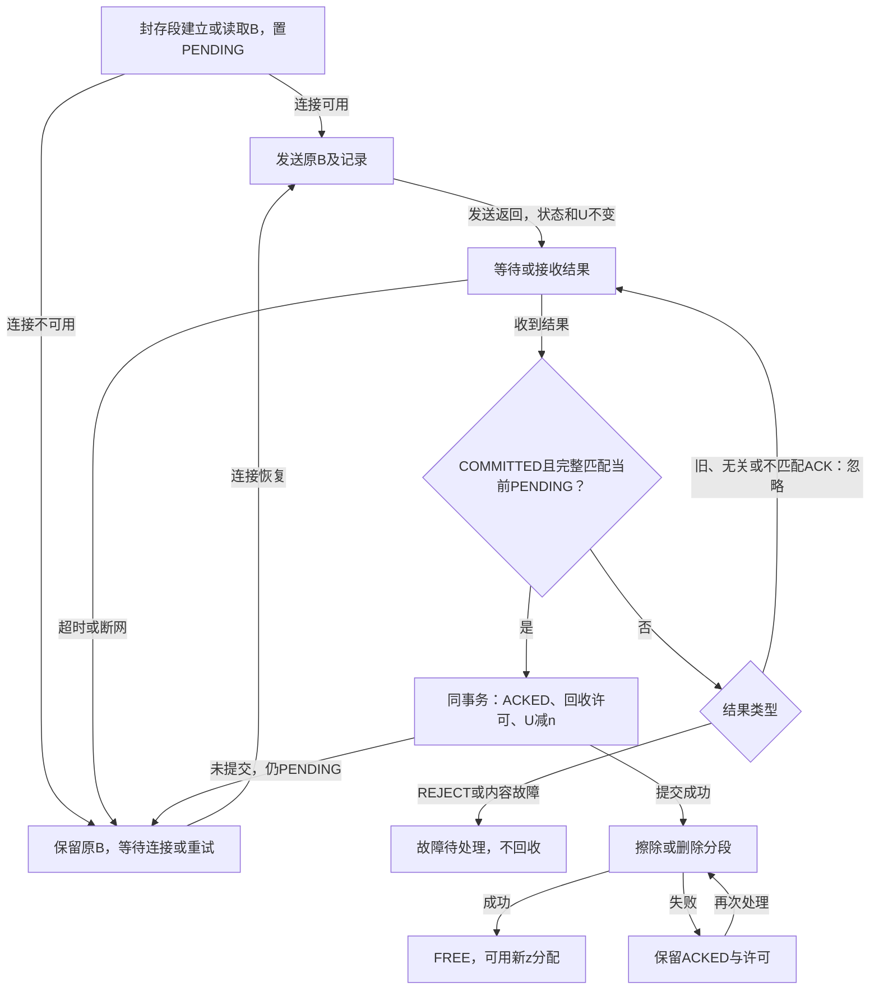
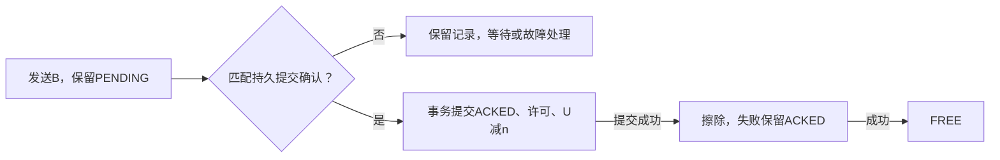
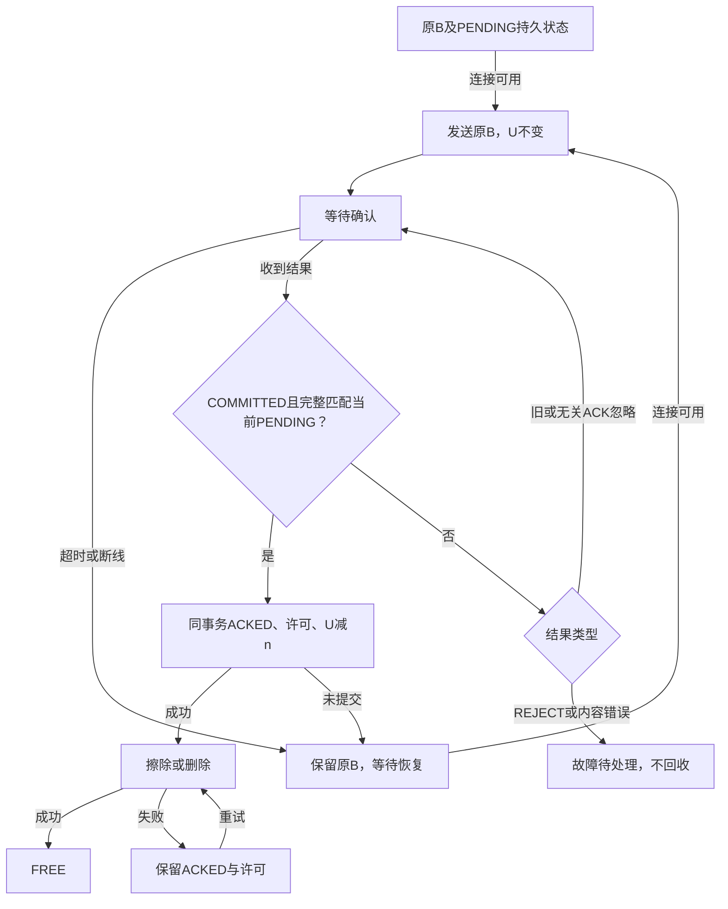

# CN 工业采集网关：从设计到起草、冲突处理及修改答复

版本：`cn-gateway-example-d1.2`；编写日期：2026-11-01。本文是参与开发夹具设计的作者编写的合成示范，非独立作答、隐藏验收或专业签核。三个案例共用技术题材但分别限制材料，不能计为三个独立稳定性样本。设计、D1/D2、原提交稿和审查意见均为合成；未进行真实检索、实现、试验、申请或答复提交。

修订记录：本版资源`d1.2`对应正常稿`N-v2`、冲突案条件候选`C-S-v2`、修改稿`V-v3`及OA延伸`OA-response-dev-v2`。初稿`N-v1`/`C-S-v1`/`V-v2`及其回答、首次评分另行保全；本版仅作受提示的作者修复，不覆盖首次结果、不表示独立复验。两独权及采用S设计为条件的候选1补入原材料已有的槽位世代持续不重复关系，从权删除重复限定；该条件没有消除访谈I与设计S的冲突，原合成提交稿O-v1不变。

本资源与[核心方法](cn-core-method.md)配合使用。规则研究依据为[本轮 CN 官方依据核验记录](../../../references/jurisdictions/cn-core-evidence-20261101.md)中 CNCORE-01—07、09—10；该记录是有限来源核验，未接受专业签核。此处的虚构历史日期不决定真实案件的规则适用时点。本文只示范给定集合分析、内部写作与修改；其他地区或技术领域须另行核验。

## 0. 三案的材料边界

### 0.1 正常案 S-v1 的原始设计摘要

下表保留稳定段号。数字是设计配置或手算值，均不是测试值。原始设计已给出足以起草的处理链，可完成完整内部候选；跨擦除恢复记录高水位的具体机制仍需技术确认，详见1.4，不能因此称实际实现充分性已通过。

| 原段 | 已提供的设计事实 |
| --- | --- |
| S-01 | EG-Cache 为工业边缘采集网关设计。无样机、程序运行或实测；拟作 CN 发明内部稿，主体和真实日期未定。 |
| S-02—03 | 传感器向网关 G 输入；G 有处理器、持久存储和网络接口；接收端 C 有事务数据库。考虑非恶意丢失、重复、迟到和重启，依赖持久事务；不承诺永久损坏、篡改或传感器未接收数据的保护。 |
| S-04—05 | 设备标识 g、运行世代 e 普通重启不变；q 在同一 g/e 内随已提交记录递增，溢出暂停而不回绕。记录含通道、时间、值、长度及校验；时间不作唯一身份。按字段固定顺序、带长度编码，摘要 h 为有序记录字节的 SHA-256，非对抗安全保证。 |
| S-06—07 | K 个可回收槽位，K≥2；槽位号 s 固定，每次新分段持久递增 z，不回绕。记录只追加到 OPEN。记录及 U 增1同事务提交；失败或不完整尾记录不计入 U、不发送。演示 K=4、N=3。 |
| S-08 | 达到正整数 N 条记录封存；重连也封存非空尾段。空段不产生批次，封存后不追加。基础实施方式没有持续在线定时封存。 |
| S-09—10 | 一段一批次 B=(g,e,s,z,q_first,q_last,n,h)，n 为实际条数且等于末序号减首序号加1。B 持久保存后转 PENDING；按首序号发送，同一时刻最多一个不同 B 在等待确认窗口。发送成功不扣 U、不回收。 |
| S-11—12 | C 校验条数、区间和摘要；记录键为(g,e,q)。新记录和 B 提交结果同事务持久提交后才返回 ACK(B,COMMITTED)。同键异内容拒绝；同 B 同内容重发不重插、重返确认。接收端清理策略未设计。 |
| S-13 | 只有 COMMITTED 且全部字段与当前 PENDING B 相同才允许确认提交。REJECT、旧世代、区间/数量/摘要不匹配不扣 U、不回收。 |
| S-14—15 | PENDING→ACKED、B 的回收许可及 U减n 同事务且只执行一次；提交后擦除，成功才 FREE。擦除失败保留 ACKED 继续处理。旧 ACK 对 ACKED、FREE 或新 z 不再扣 U；不要求永久保留每份旧 ACK。 |
| S-16—18 | 示例确认超时 T=5 s；超时/断线重发同 B。内容错误进入故障处理，不无限重发坏数据。满存储暂停接收；恢复区分 OPEN、SEALED、PENDING、ACKED、FREE。校验不一致隔离；不凭发送日志扣 U。 |
| S-19—20 | 断网写 q=1—3 到 s0/z1、q=4—5 到 s1/z1，U=5；重连封存尾段。首批 ACK 丢失后同 B 重发，匹配确认令 U=2；重复 ACK 不变，第二批匹配确认令 U=0。s0/z2 不受旧 z1 ACK 影响；事务前/后崩溃恢复不同。 |
| S-21 | 预期作用来自身份匹配、单次状态迁移和提交后擦除。没有吞吐、时延、寿命、失效率或提升比例数据，不能写全故障零丢失。 |
| S-22 | 持久事务可用数据库事务或具等价恢复语义的日志实现；回收可擦除块或删除分段文件；C 可在工厂内或远端。无多服务器多数确认协议。 |
| S-23 | 独立替代实施方式以 M 字节容量替代 N 条数，示例 M=1024；追加前不够则封存已有非空段再写新段，单条超 M 拒收。未设计 N 与 M 同时满足才封存。重连尾段及其后的流程相同。 |
| S-24 | 仅允许本项目模型内部开发和本地保存，无真实技术或专业签核、申请、公开、付款、签署、联系或外发授权。 |

### 0.2 正常案给定的两篇完整合成文献

D1《离线记录的分块发送与删除》，虚构公开日2024-04-10；D2《消息接收端的重复记录处理》，虚构公开日2024-09-20。正常案虚构关键日为2025-02-10。它们仅用于演练集合内的先后关系，不存在真实公开号、官方状态、公开证明或数据库命中。

| 段号 | 合成全文的技术内容 |
| --- | --- |
| D1-01 | 断网数据按固定条数成块，本地保存，重连按形成顺序发整块；块含设备编号、块编号和记录数。 |
| D1-02 | 服务器写文件，写入返回成功即回复块编号成功回执；设备收到与当前块编号相同的成功回执后删除，发送失败保留待重连。 |
| D1-03 | 无回执重发同块；未规定服务器重复合并，也未规定写入成功与断电持久性的关系。 |
| D1-04 | 设备编号安装时配置，块编号进程启动从1重计；块删除可复用存储位置。回执只有块编号和成败标志。 |
| D1-05 | 没有记载槽位世代、内容摘要回执、计数/许可事务或删除中断恢复。 |
| D2-01 | 设备标识、启动世代、递增序号构成逐消息键；同键同内容不重复插入。 |
| D2-02 | 数据库事务成功提交后发逐消息确认；发送端对应确认后删该条消息，缺确认重发；确认含消息键及提交成功标志。 |
| D2-03 | 同键异内容返回冲突；持久状态延续时世代不重置，重新初始化换世代。 |
| D2-04—05 | 未记载可回收分段、槽位世代/区间/条数/摘要的批次身份、批次计数或擦除日志；目的为接收端不重插，没有批次回收/复用设计或性能对照。 |

上述是完整合成文献的全部技术内容摘要。第2案只有指定摘录，不能把本节中其他段落或虚构日期迁入该案。

## 1. D1-PAT-N：资料充分的正常起草

### 1.1 完整技术交底与保护选择

交底对象是工业采集记录从 G 的持久分段传到 C、再释放本地存储的过程。被保护的具体问题不是一般“网络不可靠”：第一，服务器已提交但确认丢失，会使重发消息重复到达；第二，旧确认迟到且本地槽位已经复用，按槽位或块编号直接回收可能删除新数据；第三，确认、计数、擦除之间崩溃，可能使恢复后重复扣减待确认计数或错误判断可回收。三者分别由接收端重复处理、完整批次匹配和本地持久状态迁移处理，不能只用“唯一编号”概括全部作用。

G 接收记录后持久形成 OPEN 分段，满 N 条或重连非空尾段封存。每段的内容被冻结，B 同时标识设备/运行世代、槽位/复用世代、记录范围/数量及内容。发送调用成功只是传输层事件；C 校验并持久提交才形成 COMMITTED。G 的有效确认必须绑定当前 PENDING 的完整 B；把确认、回收许可及 U 的扣减一起提交后，才能擦除；失败擦除不重复计数事务。未匹配、重发、满容量、重启与故障隔离按0.1所列条件处理。

核心选择是把“槽位世代每新段持久递增、普通重启不重置且不回绕＋完整身份匹配＋一次持久确认事务＋随后物理回收”的关系放入独立权项。只列描述符字段和当前PENDING并不限制身份值复用；若e、q、z均可在新段重复且记录字节相同，旧COMMITTED就可能与新PENDING完整匹配。当前主项选择S-06/15已给出的z持续不重复关系封闭这一分支，不从从权7借入e/q限制。它是本稿采用的有据限缩路线，不是声称在已保留另一完整不复用身份机制时，单独删除z也必然导致误配。较宽路线只限定确认后回收，覆盖面较大，但D1已有直接接近内容，且无法承担本案迟到确认及崩溃窗口的效果。较窄路线再加入接收端按记录键去重和重返批次确认，更完整覆盖端到端重复处理，但要求观察接收端行为、可能排除采用其他接收实现的方案。本文选第一路线作为主项，把接收端机制列入从权3。N=3、K=4、5秒、SHA-256具体算法不都放入独权：前三者只是配置/推演，摘要算法是已给实现；本文独权保留“有序记录内容摘要”，其概括仅指所述内容一致性用途，不泛化成任意安全认证。

| 特征/关系 | S支持 | 对本稿的作用 | 拿掉后的反例或代价 |
| --- | --- | --- | --- |
| z每新段持久递增、不回绕、普通重启不重置，再与冻结B完整匹配 | S-06/09/13/15 | 在本槽位持久状态延续及复用中排除旧B命中新段 | 若独权只列B字段而不约束任一身份不重复，e/q/z和同字节均可再现，旧B可命中新PENDING；当前主项的z条件排除它。不能据此断言其他完整身份不复用条件均保留时单删z必然误配 |
| 远端持久提交后COMMITTED | S-11—12 | 确认指向已提交数据 | 写入调用返回但未持久化，G回收后可能无可恢复副本 |
| 当前PENDING逐字段匹配 | S-13、15 | 迟到/重复确认不能授权当前段 | 对已ACKED再次扣n会使U错误；新z不能接受旧z |
| 状态、许可、U同事务 | S-14、18、20 | 确认提交只发生一次并可恢复 | 状态与U各写一次但无共同提交，重启可能重复扣减 |
| 事务后擦除，成功再FREE | S-14、17—18 | 区分逻辑许可与物理释放 | 擦除失败就分配新段会重用尚未释放的槽位 |
| 单批窗口、满容量暂停 | S-10、17 | 本实施方式的边界可解释 | 多批并行或覆盖未确认段需另设计，不能从本文保证推得 |

### 1.2 给定集合比较与检索计划

| 本稿必要关系 | D1单篇 | D2单篇 | 工作判断 |
| --- | --- | --- | --- |
| 断网分段、重连发送、回执后删除 | D1-01/02直接记载 | D2-01/02为逐消息，不是所给分段流程 | 单靠这一宽流程不足以形成有力区别 |
| C持久提交后确认、同键同内容不重插 | D1-02/03未明确持久性和重复合并 | D2-01—03直接接近 | 不能把接收端去重本身当本案独有贡献 |
| 一段一B，B绑定槽位z、序号区间/n和h | D1-01/04的设备/块号/数，回执不含完整关系 | D2-04未记载批次/槽位关系 | 给定两篇各自未覆盖本稿完整关系 |
| 当前PENDING匹配后同事务更新ACKED/许可/U | D1-05无该记载 | D2-04/05无批次计数或本地擦除日志 | 仍需面对把事务用于本地状态的一般化组合质疑 |
| 事务前后恢复及擦除失败重入 | D1-05无 | D2-05无 | 效果依赖设计前提，不是实测优势 |

单篇比较中，没有把D1与D2拼成一篇。因此这里只能说给定完整合成文本未单篇明确记载所选关系，不能据此作真实新颖性结论。演练中两篇虚构日期早于虚构关键日；实际现有技术资格没有核验。

创造性工作分析以D1为接近起点，因为它同样以分段回收本地存储。区别主要是持久不复用的槽位世代与完整批次身份结合、本地一次确认事务及恢复顺序；依据设计可形成的问题是“在重传、确认迟到和重启时，使本地释放与已提交批次保持一致”。这个问题未预埋具体z、摘要或事务答案。D2有引入持久消息身份及提交后确认的明确技术动机，支持组合质疑；不能只因它按消息处理就拒绝组合。需继续核组合能否自然到达整段复用、计数与物理擦除间的特定关系，以及相关日志/事务是否属于有证据的常规实现。本文不把这些剩余缺项直接判为创造性成立。

真实检索执行次数为0。后续计划先用“store and forward / offline telemetry / segmented buffer / acknowledgment”找宽概念，再用“generation counter / stale acknowledgement / crash recovery / reclaim journal”找关系；中文用“离线采集、分段缓存、确认、世代、回收、重启恢复”等对应词。查询是待按获准来源语法适配的概念组合，分类号尚未核实。需要覆盖专利和非专利存储/消息系统资料、核全文及公开日、记录实际库/查询/分页/停止原因。不得把本表当查新报告或FTO。

<!-- BEGIN D1-PAT-N WORK PRODUCT -->
### 1.3 正常案完整正文候选 N-v2

本节为合成设计的内部申请文本候选，待技术确认与CN专业审阅；以下技术陈述描述设计，不表示已经实现或实测。

#### 发明名称

一种采集记录的分段传送与回收方法

#### 权利要求书

1. 一种由网关执行的采集记录的分段传送与回收方法，其特征在于，包括：为每个本地可回收槽位保持固定的槽位号，每次在该槽位开始新的分段时递增并持久保存该槽位的槽位世代，普通进程重启不重置所述槽位世代且所述槽位世代不回绕；将具有记录序号的采集记录持久保存于本地可回收槽位中的分段，并维护已提交且尚未确认的记录的待确认计数；在封存分段后，冻结该分段的记录集合及顺序，持久保存对应批次的描述符并将该分段置为待确认状态，所述描述符包括设备标识、运行世代、槽位号、槽位世代、首记录序号、末记录序号、记录数和有序记录内容摘要；在连接可用时发送所述描述符和该分段的记录；接收由接收端对所述批次的记录及批次提交结果进行持久提交后返回的提交成功确认，仅在所述确认中的上述字段与当前待确认状态的描述符逐字段相同时，执行一个持久事务，在该事务中将该分段从待确认状态变为已确认状态、写入该批次的回收许可并使所述待确认计数减少该分段的记录数，所述事务仅允许从待确认状态执行一次；在该事务提交成功后擦除或删除该分段的记录，并在擦除或删除成功后将其槽位置为空闲状态。

2. 根据权利要求1所述的方法，其特征在于，采集记录追加于开放状态的分段，记录的持久提交与所述待确认计数增加1由同一事务完成；当该分段达到配置的正整数条记录时封存该分段，连接由断开转为可发送时也封存当前非空的开放状态分段，空分段不生成批次，封存后不再追加记录。

3. 根据权利要求1所述的方法，其特征在于，所述提交成功确认由接收端在校验记录数、记录序号区间及有序记录内容摘要与所述描述符一致后生成，接收端以设备标识、运行世代及记录序号作为记录键，将尚未保存的记录与批次提交结果由同一事务持久提交；接收端再次收到描述符相同且内容一致的批次时，不再次插入记录而重新返回所述提交成功确认，相同记录键但内容不同的消息不获得所述提交成功确认。

4. 根据权利要求1所述的方法，其特征在于，按照首记录序号顺序选择批次，同一时刻最多一个不同批次处于发送和等待确认窗口；等待确认5秒超时或连接中断时，保留所述描述符及记录，连接可用时重发同一批次，不因发送调用成功或等待超时减少所述待确认计数。

5. 根据权利要求1所述的方法，其特征在于，所述持久事务提交前发生重启时，依据持久状态保留待确认状态并按原描述符重试；所述事务提交后且擦除或删除完成前发生重启时，依据已确认状态及回收许可继续擦除或删除；擦除或删除失败时保留已确认状态，后续重试擦除或删除而不再次减少所述待确认计数。

6. 根据权利要求1所述的方法，其特征在于，无空闲槽位时暂停接收新的采集记录并继续处理确认及已确认分段的擦除或删除，有空闲槽位后恢复接收；不覆盖待确认分段、已封存分段或尚未完成擦除或删除的已确认分段。

7. 根据权利要求1所述的方法，其特征在于，运行世代在普通进程重启时保持不变，同一设备标识和运行世代内的记录序号随记录一并持久提交并单调增加，重启后根据已提交最大记录序号继续分配；记录序号达到可表示的最大值时暂停接收并报告维护而不回绕复用。

#### 说明书

##### 技术领域

[N-0001] 本设计涉及工业数据采集和持久数据传送，具体涉及边缘网关在链路中断、批次重传及重启条件下的分段记录确认与本地回收。

##### 背景技术

[N-0002] 本开发案给定的合成资料D1描述断网分块保存、重连发送以及收到块编号成功回执后删除；合成资料D2描述按设备标识、运行世代和消息序号进行接收端重复处理以及持久提交后逐消息确认。上述资料只用于本示范的给定集合背景，不是实际检索证据，也不表示对整个技术领域作出概括承认。

[N-0003] 当以本地分段而非单条消息作为回收单位时，应同时考虑确认所指的设备和运行状态、槽位是否已复用、确认是否对应同一内容以及确认与回收之间的崩溃窗口。本设计处理的情形包括确认丢失引起的重发、旧确认迟到以及本地确认提交或擦除中断。

##### 发明内容

[N-0004] 本设计提供一种将已封存记录与批次描述符绑定、将确认与本地回收许可绑定的方法。同一槽位每次开始新分段时递增并持久保存槽位世代，普通进程重启不重置且不回绕，使该槽位的新分段不再采用旧槽位世代。网关只对与当前待确认批次完整匹配的提交成功确认，持久地一次提交状态、回收许可和计数变化；随后才执行物理回收。逻辑上的允许回收与物理上的完成回收为不同事件。

[N-0005] 系统包括传感器输入、网关G和接收端C。G通过输入接口取得记录，其处理器管理持久存储和网络接口。C通过网络取得批次并使用事务数据库保存记录和提交结果；确认由C返回，实际回收由G执行。C可以位于工厂内或远端，位置不改变确认条件。

[N-0006] 本设计考虑非恶意的消息丢失、重复、迟到和进程重启，假定持久事务在重启后可恢复。永久介质损坏、双方持久数据同时丢失及对抗性篡改不属于该设计保证。暂停输入期间未被G接收的传感器数据不属于已接收集合。

[N-0007] 在上述前提下，每新段持久递增且重启不重置、不回绕的槽位世代与完整匹配共同使旧批次确认不能授权同槽位的新分段；只允许从待确认状态执行的事务避免重复确认重复扣减；事务后擦除以及对已确认状态的恢复，使擦除重试不重做计数事务。以上是机制推论，没有实测性能或全故障零丢失结论。

##### 附图说明

[N-0008] 图1为系统关系框图，示出采集输入、G的处理器/存储/网络以及C的事务接收和确认方向。图2为已封存批次的发送、确认、回收及故障处理流程。图2的W、H分别承接事务提交前和提交后的恢复路径；图中FREE只表示擦除成功后可重新分配。可编辑图源见本节末。

##### 具体实施方式

[N-0009] 设备标识记为g，运行世代记为e。e在部署初始化时持久保存，普通进程重启不更改，更换存储或重新初始化建立新e。记录序号q在同一g/e内单调增加，随记录持久提交；重启后依据已提交最大序号继续。该恢复依据必须在已确认分段被擦除后仍可取得，不能只扫描尚存记录来确定最大值；原材料未给出高水位元数据或日志的具体布局，须由技术负责人确认，本文不虚构其已实现方式。达到可表示最大值时暂停接收并报告维护，不回绕复用。

[N-0010] 记录包括g、e、q、通道c、采集时间t、采集值v、长度和完整性校验值。t不承担唯一身份或确认排序。各字段按固定顺序、带长度编码；对批次内按顺序排列的记录字节计算SHA-256得到h。摘要用于内容一致性检查，本实施方式不以其替代身份认证或对抗安全机制。

[N-0011] 本地存储分为K个可独立回收槽位，K为至少2的正整数；每个槽位具有固定s及持久的槽位世代z。每次建立新分段先递增并保存z，重启不清零且不回绕。一个分段只占一个槽位，包含分段头、记录区和提交标记。演示配置为K=4、每段最多N=3条，数值不是优化结果。

[N-0012] 新记录只写入OPEN分段。完整记录及其提交标记持久成功、U增加1为一个事务；只有提交后记录才进入已接收集合。写入失败或恢复发现不完整尾记录时，不计入U、不发送尾记录，保留错误并按输入接口重试协议处理尚未接收的数据。

[N-0013] OPEN达到N条已提交记录时转为SEALED，冻结集合及顺序，并在可用空闲槽位开新段。断网转为可发送时，将当前非空OPEN尾段封存；空段不封存。持续连接且未达到N时，基础实施方式继续等待新记录，没有定时封存承诺。

[N-0014] 每个SEALED分段对应一个B=(g,e,s,z,q_first,q_last,n,h)。n为实际条数，段内序号连续，n=q_last-q_first+1。保存B后分段转为PENDING；此后不改内容、顺序或B。不同槽位、不同z或不同内容不因条数相同而成为同一批次。

[N-0015] G在连接可用时按q_first顺序选择批次，同一时刻最多一个不同B处于发送/等待确认窗口。发送消息携带B和完整记录。发送调用返回成功后仍为PENDING，U不变；无可发送封存段时等待采集或连接事件。

[N-0016] C检查记录数、序号区间、摘要与B是否一致。检查失败返回带该B的REJECT且不提交批次。成功时以(g,e,q)作记录键，将尚无记录与B的提交结果在同一事务内持久保存；同键内容冲突则拒绝。仅事务持久成功后返回ACK(B,COMMITTED)。

[N-0017] 若C已有同一B的成功结果，且重发内容与B一致，则不再插入记录并重新返回确认。不同描述符或内容不能借用旧成功结果。接收端记录键与提交结果应在重启后保留；本文没有完成其清理策略，不能推导无限保留能力。

[N-0018] G收到结果时查找当前PENDING B。仅COMMITTED且g、e、s、z、q_first、q_last、n、h全部匹配才进入确认事务。旧e/z、未知B及区间、数量、摘要不一致不扣U、不授权回收；无关或旧确认被忽略并继续等候当前有效结果。内容错误或REJECT进入故障待处理，不能无限重发相同坏数据来假定故障消失。

[N-0019] 有效确认触发持久事务：PENDING变ACKED、写入B的回收许可、U减少n一起提交。该事务只允许从PENDING执行一次。提交前不允许擦除；提交成功后执行擦除块或删除分段文件；成功后才置FREE。失败则保留ACKED和许可，稍后继续擦除，不再减少U。

[N-0020] 已ACKED、FREE或已作为新z使用的槽位，不存在与旧B相同的当前PENDING，因此重复或迟到ACK不会再授权该段或扣U。网关保留当前槽位世代及恢复日志，无须由本设计要求永久存储每份旧ACK。

[N-0021] 演示等待确认超时为5秒。超时或断网时保留原B和记录，重连后重发同B，不因此新建z。该时间是重试配置，不是上传完成时限；没有给定其他数值的性能依据。

[N-0022] 无FREE槽位时暂停接收新采集记录，继续处理确认和ACKED擦除；有FREE后恢复。不可覆盖SEALED、PENDING或未擦除完成的ACKED。容量事件不能替代远端确认。

[N-0023] 重启恢复完整提交记录及持久状态。OPEN仅恢复完整记录；SEALED读取或建立B；PENDING保留原B重试；ACKED按许可继续擦除；FREE可以分配新z。U从已提交但未转ACKED的记录数或等价事务日志恢复，不能用发送成功日志扣减。描述符与记录校验不符时隔离并等待故障处理。

[N-0024] 事务提交前崩溃，恢复状态仍为PENDING，可重发原批次取得确认；事务提交后擦除前崩溃，恢复ACKED，继续擦除，U不再扣减。数据库事务或具同样提交/恢复语义的先写日志均可实现所述持久事务，不能只记录一条普通日志就推定具有等价语义。

[N-0025] 手算例中，q=1、2、3先写s=0/z=1并封存，q=4、5写s=1/z=1，U=5。重连封存第二段。首段远端提交而首份ACK丢失，超时重发原B，C重返确认，G一次提交后U=2。重复ACK仍为2；第二段有效确认后U=0。首段释放后建立z=2，旧z=1确认不匹配新分段。本段为设计推演，没有实际执行记录。

[N-0026] 一个独立替代实施方式用已提交字节容量M替代记录数N作为封存依据。示例M=1024字节；追加前若剩余空间不足则先封存已有非空段，再在新段写入；单条超过M拒收报错。重连时非空尾段封存及后续B/确认/回收相同。此实施方式不要求同时达到N和M，不能把两个独立方式改写为双阈值AND。

[N-0027] 仍需由技术负责人验证事务实现、介质约束、输入暂停/重试及接收端提交结果保留方案，并由专业人员审阅范围和可实施性。没有加入多服务器多数确认、加密认证、持续在线定时封存或未提供的性能范围；这些若成为需求，应取得对应设计后再评价。

#### 摘要

提供一种采集记录的分段传送与回收方法。网关在每个槽位开始新分段时持久递增槽位世代，普通重启不重置且不回绕；封存记录后建立含设备、运行世代、槽位、槽位世代、记录范围、数量及内容摘要的批次描述符。接收端持久提交后返回确认。网关仅对与当前待确认批次匹配的提交成功确认，一次持久提交已确认状态、回收许可和计数变化，再擦除分段，成功后释放槽位。重复或迟到确认不再次扣减计数；重启后按待确认或已确认状态分别重发或继续擦除。

#### 可编辑图源及图文对应

图1：系统关系。下面的Mermaid为可编辑源，语义来自S-02、11—12；显示结果尚需实际渲染检查。

图2：批次确认及回收。权利要求1、4、5对应此图；正文N-0011及N-0014—0024解释身份前提和节点。图从已封存段开始，其槽位世代已按每次新段持久递增、普通重启不重置且不回绕的条件取得；F之后再次分配仍遵守该条件。根级画图工序可将以下同一语义输出为[SVG图源](cn-gateway-flow.svg)，但文件链接不表示已完成观察或验收。

恢复说明：事务前崩溃承接W，事务后擦除前承接H；OPEN/SEALED/FREE的完整恢复见N-0023。图中不设置故障X自动回成功的箭头。已ACKED/FREE或新z收到旧ACK，没有匹配的当前PENDING，不重做T。

<!-- END D1-PAT-N WORK PRODUCT -->

### 1.4 支持反查、反证与作者修订

| 权项/关系 | 原支持 | 正文/图 | 核稿范围 |
| --- | --- | --- | --- |
| N-C1持久不复用z→封存B→完整确认→事务→擦除 | S-06/15给z延续，S-09/13/14把该z纳入同一批次确认回收流程 | N-0004/0007/0011—0019；图2身份前提及A/M/T/E/F | 主项自身已有z递增/持久/普通重启不重置/不回绕，不借N-C7的e/q；未把“有摘要”推成任意安全协议 |
| N-C2写入事务、条数/重连封存 | S-07/08 | N-0012/0013 | 记录数方式，从权未声称持续在线定时刷新 |
| N-C3接收端事务/去重/冲突 | S-11/12 | N-0016/0017；图1 | 仅约束所接确认产生条件，无已实施事实 |
| N-C4单批窗口/5秒同B重试 | S-10/16 | N-0015/0021；图2 W/S/Q | 5秒非性能保证；该从权有主动限缩成本 |
| N-C5事务前后恢复/擦除失败 | S-14/18/20 | N-0019/0023/0024；W/H | 未把两崩溃窗口写为同一路径 |
| N-C6满容量暂停 | S-17 | N-0022 | 不覆盖未确认数据；暂停期间未接收数据不获零丢失保证 |
| N-C7追加e/q延续及q上限 | S-04；所依附N-C1的z条件另据S-06/15 | N-0009；N-0011的z关系由N-C1承担 | 删除z重复，保留e普通重启及q递增/恢复/上限；跨擦除恢复q高水位的机制待技术确认。z耗尽后的具体处理未给，不添加确定动作 |
| 字节容量替代 | S-23 | N-0026 | 不在依赖N-C2的链上拼成AND；如另写该从权，须完整给出先检查/超长拒收机制 |

补充实施缺口：S-04要求重启从已提交最大q继续，S-15保留恢复日志，但未说明全部旧分段擦除后高水位的具体保存方式。仅扫描存活分段会违背q不复用要求；本稿保留持续身份要求，不虚构新的元数据布局或测试结果。该缺口由技术负责人确认，关联接收端(g,e,q)去重与N-0009/0023，内部稿可审，实际实现充分性不能据此报通过。

本组依赖为2→1、3→1、4→1、5→1、6→1、7→1；各从权引用术语来自1或自身引入，没有借用兄弟项。所有必要替代均由S-22/23提供；没有增加系统/介质权项以凑类别。

最强反证是：D1已提供批次回收需求，D2提供持久消息身份、去重和提交后确认；工程人员为了让回收在重启后可靠，可能自然使用本地事务/日志。若进一步检索得到把槽位代际与释放日志结合的资料，主项的贡献可能显著收缩。响应不能是“D2没有逐字写出B”：应核该证据是否真正揭示整段内容绑定、当前PENDING单次迁移与计数/擦除顺序。当前两篇并未给出这些关系，但仍不足证明不存在组合启示或常规手段。

可绕开方向是逐记录持久确认并逐记录删除，不用可独立回收分段及其批次身份；可能避开本稿的分段关系，同时增加确认/存储管理开销，但没有数据量化。另一方向使用不同的全局批次唯一身份而不以槽位z组成确认；是否仍落入其他权项解释或等同问题不在本给定集合中判定。对这些方向应分别验证容量、恢复、记录去重和对应权项，不能宣布自由实施。

作者实际修订选择：未采用仅“收到确认后删除”的宽独权；初稿仅把完整匹配与状态/许可/U同事务写入N-C1，却把身份延续留在从权，仍容许未受约束的身份值全部复用。当前N-v2把S-06/15的z持久递增、普通重启不重置且不回绕纳入N-C1，N-C7只保留e/q附加层，N-0004/0007、摘要及图义说明同步；N-0011既有z技术事实未改变。这是有原始设计依据的实质限缩，不是初稿已满足该条件，也不是可授权结论。另将5秒移到从权4、保留N/M为独立实施方式，避免把演示数值与未提供组合当成核心贡献。上述是开发作者的文本自查，不是模型实跑或独立评分。

状态推演逐项结果：初始已收5条时U=5；首批提交确认一次后U=2；其ACK重复及z1旧ACK对z2均不改变该时点U；第二批有效确认后U=0。若事务前崩溃，未提交扣减仍无效；事务后崩溃，恢复ACKED且扣减不重做。擦除失败保留ACKED；空段不生B；满存储暂停；坏内容隔离。这些结论是对S手算条件的检查，未实际运行系统。

### 1.5 正常案交付与未完成项

| 分区 | 实际产物与版本 | 接收责任及下一步 |
| --- | --- | --- |
| 正文候选 | N-v2：7项权项、27段说明书、摘要、2图可编辑源 | 技术负责人确认可实施设计；CN专利专业人员审阅范围、支持、形式及给定集合工作意见 |
| 内部记录 | S支持表、D1/D2比较、反证、范围取舍、上述推演 | 保留同版关联，不能把这份记录充当检索结果、专业签核或外发附件默认批准 |
| 行动条件 | 本项目模型开发及本地保存已在S-24范围内 | 拟对外包、实际接收对象、用途、渠道、批准角色、有效条件均未确定；没有发送、提交、付款或签署 |
| 观察/规则 | 图源可读、依据记录可引用 | 实际SVG/页面/打印尚需独立记录；官方依据只完成有限核验，真实案规则适用及专业审阅未完成 |

## 2. D1-PAT-C：冲突和有限摘录下继续交付

本案是作者在已知开发全库的情况下按材料边界编写的示范，不能证明执行输入隔离。下述技术比较只使用本案给定的D1-01/02、D2-01/02；不使用0.2其他段、全文缺项结论或虚构日期。本案真实关键日及文献公开证据未知。

### 2.1 本案来源与冲突

I-01访谈甲称“发送函数一返回成功就擦掉分段，服务器回执晚到没有关系”，没有代码/日志/版本。I-02访谈乙称“重启把槽位世代z清零，省一次闪存写入”，又表示不确定目前版本是否已改，没有证据。I-03确认输入接口、处理器、持久存储、断网分段及重连封存非空尾段。I-04管理员说明S和I指向同一拟定版本，无自动优先级、无代码/设备/测试，允许写明确的可实施设计候选，不能声称事实已解决。

| 冲突 | 对照位置 | 实质影响 | 当前处理 |
| --- | --- | --- | --- |
| 发送即擦除/提交确认后回收 | I-01 对 S-10/13/14 | 发送成功不代表C持久提交；提前删掉后，REJECT或远端提交失败可能无本地重发记录 | 两分支并列，实际实现未定；S条件候选可写，实际机制不宣告已确认 |
| 重启z清零/持久不回绕 | I-02 对 S-06/15 | 槽位复用身份条件改变，不能沿用S的世代区分理由 | 请求恢复实现证据；不能仅凭该句断定完整B必然相同，因e/q/h仍影响匹配 |

特别区分第二项的风险强度：z清零破坏S中“新段z不同”的保证，但并不单独证明一次旧ACK一定命中新B。若其他字段仍严格匹配且q持续递增，可能继续拒绝；若实现又只看s/z或重置其他字段，则有误配路径。由于实际确认比较和其他持久字段未取得，应报告条件风险，不编造已发生删除事故。

### 2.2 不依赖争议的交底正文与系统图 C-common-v1

本项目拟用于工业采集数据在连接中断期间的本地保存和恢复连接后的传送。传感器经输入接口向网关提供数据，网关包含处理器、持久存储器和网络接口；网关按分段组织记录，连接恢复时封存当前非空尾段，再把分段内容发给接收端。接收端返回处理结果。上述架构、断网分段和重连尾段来自S-02/08及I-03的共同记载。

记录字段和批次描述符的完整设计见S-04—09，但访谈没有提供实际固件证据，因此可作为设计内容继续整理，不能据此确认实际实现。实际回收触发与重启世代处理在两来源间冲突，本共同稿不确定这两个动作。输入处理、分段组织和传送方向可以先供技术审阅；回收可靠性效果不能附着在此共同稿上。

该图只表示共同结构。没有绘制确定的“发送成功→回收”或“提交确认→回收”箭头，亦未声称已运行或截图检查。

### 2.3 S设计分支的实际候选 C-S-v2

本分支条件是“选择实施S所述设计，尚未确认其就是当前固件”。权项、正文与图共同带此条件；不能剪去条件后作为实际实现已确认稿。

权利要求候选1：一种由网关执行的采集记录传送与回收方法，包括为每个本地可回收槽位保持固定的槽位号，每次在该槽位开始新的分段时递增并持久保存该槽位的槽位世代，普通进程重启不重置所述槽位世代且所述槽位世代不回绕；将记录持久保存在本地分段，封存后以设备标识、运行世代、槽位号、槽位世代、首末记录序号、记录数及有序记录内容摘要构成批次描述符并保存待确认状态；连接可用时发送该批次；仅在接收到接收端持久提交后返回、且上述字段与当前待确认描述符逐字段相同的提交成功确认时，以一个持久事务一起提交已确认状态、回收许可及待确认计数减少该段记录数；该事务提交成功后才擦除或删除该分段，成功后释放槽位，所述事务仅从待确认状态执行一次。

权利要求候选2：根据候选1所述的方法，其中普通进程重启保持运行世代；确认事务前重启按原描述符重试，确认事务后而擦除前重启按回收许可继续擦除，不重复扣减计数。

说明候选：本分支将发送事件和回收许可分离。发送后分段仍处于PENDING且记录保留；确认必须表明C已持久提交，并与冻结B全部字段一致。匹配后事务化迁移为ACKED及扣减U，之后执行擦除。重复旧确认没有同一PENDING可供迁移。z不因普通重启清零，新的槽位内容取得新z；该设计使槽位复用可以在确认身份中辨识。擦除失败继续ACKED，不能先置FREE再修复。以上依据S-06/09—18/20，并未解决I-01/I-02的实际版本冲突。

范围与支持取舍：候选1已在自身范围内纳入S-06/15的固定槽位z每新段持久递增、普通重启不重置且不回绕，不能再由候选2替其补足身份不复用关系。候选2删除重复z限定，保留S-04的运行世代延续及S-18/20的两个恢复窗口。该选择仅给出采用S时可审的限缩候选，不证明当前固件已满足S，也不消除I-01/I-02冲突；q跨擦除恢复及z耗尽动作仍待技术核实。

S分支流程源：以下节点/边与前版相同，其CSA所发送B的z以候选1所述持久分配关系为前提；这里只同步图义，没有把条件分支升级为已核实实现。

### 2.4 I分支的差异稿与反例

I分支目前只能写为：“据访谈，某未核固件在发送调用成功后擦除本地分段；重启是否重置z及当前固件是否仍如此，尚无实现证据。”不能把其后加一句“仍可保证不丢失”补成完整可实施可靠回收方案。

具体反例：发送函数返回成功，G依I-01擦除；C随后校验失败或事务未提交，返回REJECT或没有COMMITTED；G的本地分段已不存在，S中的保留原B重发路径失去数据前提。增加完整字段比较只会发现无匹配确认，不能重建已删记录。这个事件轨迹是假设性反证，不是实际发生记录。

z方面需验证的是，重启前后同s旧ACK到来时，比较使用哪些字段，e、q和z是否均持久；目前不能把“z清零”单独等同于“全部B相同”。技术负责人应检查初始化/恢复分支、确认比较函数、持久事务边界及其版本；用获准测试环境分别在确认事务前、提交后擦除前断开进程，观察状态和U恢复。未取得代码或测试，仍只列具体验证任务，不写已证实。

### 2.5 仅按摘录的文献工作意见与恢复

D1-01/02摘录已给分块存储、重连发送、写入返回后的块号回执及匹配块号后删除。D2-01/02摘录已给(g,e,q)式逐消息键、同键同内容不重插及事务提交后逐消息确认。因只有这四段，不能说D1全文没有持久事务，也不能说D2全文没有批次机制；这些均待全文。它们可以用来指出一般缓存、确认后删除和接收去重已是必须认真比较的接近内容，但不支持确定新颖性/创造性判断。日期未知另列，不能把取得摘录时间当公开日。

| 所需恢复材料 | 决定的问题 | 责任与当前可继续部分 |
| --- | --- | --- |
| 同版本发送完成/确认处理/擦除调用位置及状态日志 | I-01是否属实际行为，何事件触发回收 | 技术负责人；共同架构稿和S设计候选继续可交 |
| 初始化/恢复及完整ACK比较代码，普通重启前后字段记录 | I-02是否属当前版本，z清零对完整身份何影响 | 技术负责人；不能继承S的实际可靠性结论 |
| D1/D2全文和必要图、可核公开日期、实际关键日 | 单篇完整公开、组合与时间资格 | 检索/程序角色；已给四段有限比较继续保留 |
| 选择实施哪一分支的事实确认记录 | 哪些权项/说明/图可以作为事实定稿 | 技术负责人先确认，CN专业人员再审范围与支持 |

交付分为C-common-v1共同正文/系统图、C-S-v2条件候选、I分支差异与内部冲突表、文献缺件表。内部使用及保存可继续；向外对象、具体文件包、用途、渠道、批准角色/条件均未给，不能因共同稿可读而推为可外发。没有把冲突“清理掉”，也没有对全部工作作全局拒绝。

## 3. D1-PAT-V：原始支持、完整替换及合成OA延伸

本案仅以O-v1为演练原始提交全文；S是正常案设计来源，不能充当本案后补支持。O现实中从未提交；虚构提交日2025-02-10、OA成文日2025-06-15及收到日2025-06-18仅为演练。无真实申请号、通知或截止日。本节除原开发案要求的续接准备外，追加作者完整答复示范；该延伸不倒填原30项检查范围。

### 3.1 O-v1原始边界和提案

O原六权项的实质内容为：O-C1为断网写分段、重连发批次、收到该批提交成功确认后回收；O-C2依附1，加完整B字段及逐字段匹配；O-C3依附2，加状态/许可/U同事务、提交后擦除和重复不扣；O-C4依附3，加事务前/后重启分支；O-C5依附2，加N条/重连封存、空段不发及5秒原B重试；O-C6依附1，加满容量暂停及有空闲恢复。O-C1本身没有完整匹配或事务限定，不能把从权/说明书内容读入后宣称原独权已有区别。

| O说明段 | 本案原始支持内容；不是新补设计 |
| --- | --- |
| O-0001—0004 | G/C结构、设计边界、g/e/q持久身份、记录内容及摘要；对应原始提交正文中实际段落 |
| O-0005—0007 | O-0005明确固定s、每新段持久递增z及普通重启不重置；另含写入与U同事务、N条与重连封存 |
| O-0008—0009 | B=(g,e,s,z,首末q,n,h)，一段一批次；单批窗口、发送成功不扣U/不回收 |
| O-0010—0011 | C校验后将记录及B结果同事务持久提交；同B重发不重插而重返确认 |
| O-0012—0014 | 只有COMMITTED且与当前PENDING完整匹配才提交；ACKED/许可/U同事务，提交后擦除；O-0014明确每槽位z递增且不回绕，旧ACK不重复扣减或误回收新z |
| O-0015—0017 | 5秒重试示例、满容量、按状态恢复及不凭发送日志扣减 |
| O-0018—0019 | U=5→2→0手算与事务前/后崩溃两窗口、z复用 |
| O-0020—0022 | 条件性机制效果；数据库或等价日志、块擦除或文件删除替代；M=1024字节容量是替代N方式，未有N与M的AND组合 |

O原摘要描述相同确认/回收关系。O-F1为角色/消息方向；O-F2含原B发送、匹配判断、确认事务、擦除、失败继续与FREE。R-O-v1只是一份演练旧版图号/权项引用源级检查记录，既非真实签核也未涵盖实质范围或视觉；不迁移至V-v3。

N-01要求把完整匹配和回收事务加到独权并联动；N-02要求50毫秒等待且重连后50毫秒内全部上传，仅口头优化期望；N-03要求N与M同时满足才封存，仅以分别出现为由；N-04要求发送成功先回收而保留完整匹配，没有提前删除后恢复设计。

| 提案 | 支持和技术判断 | 采用/保留方式 |
| --- | --- | --- |
| N-01 | O-C2/3依赖链及O-0008/0012/0013给出连续组合；O-0005/0014在同一槽位生命周期明确z持久递增、普通重启不重置且不回绕，O-F2对应确认回收 | 采用为V-C1，主项同时并入身份不复用关系；连带修改正文/摘要和图义说明，程序合规仍需具体案核验 |
| N-02 | O-0015只有5秒等待重试示例，既无50毫秒，也无“全部上传完成”的性能范围 | 不进入原案替换稿；保留研发提案，取得实现/试验也不能倒成原始申请支持，后续申请/公开时点另评 |
| N-03 | O-0022明确是替代容量方式，单独出现N/M不证明AND组合；AND可能在容量已不足而计数未达时仍不封存，与原追加前检查不同 | 不采纳混合触发；保留N方式从权与M独立正文实施方式，需要新设计和独立支持路线 |
| N-04 | O-0009/0012/0013要求确认及许可事务后擦除；提前删除改变顺序 | 不采纳；发送成功但C拒绝/未持久时无本地重发内容，之后完整匹配不能恢复已删记录 |

### 3.2 路线比较及选定结果

路线A保留O-C1宽项，仅争辩“提交成功”与D1写入返回不同：修改少，但原词的机制约束不足，D2又直接提出事务提交后确认。若没有更强解释/证据，不能靠说明书中的细节替未限定独权抵挡意见。

路线B将O-C2/3的完整组合并入O-C1，同时把O-0005/0014的同槽位z每新段持久递增、普通重启不重置且不回绕纳入主项；保留O-C4/5/6和原正文支持的从属层。只并入B字段和事务仍未约束身份值是否会重复，初稿V-v2留有这一范围缺口；当前V-v3以所给原始生命周期关系限缩，承担本槽位复用下的旧确认分离。不能从V-C6借入e/q延续，也不能在已保留另一不复用身份机制时笼统断言z单独不可删除。本文选B作为可审替换。另一个更窄后备是将O-0010/0011接收去重和重返确认加入主项；本文先保留于V-C5，代价是端到端实施/取证范围更具体。不能以更多限定自动保证创造性。

### 3.3 完整权利要求替换稿 V-v3

本稿六项全部列出，替换O-C1—6；不是已提交文本。

1. 一种由网关执行的采集记录传送与回收方法，其特征在于，包括：在网络中断时将采集记录持久写入本地分段并维护已提交且尚未确认的记录的待确认计数，每个分段占用一个具有固定槽位号的可回收槽位，每次在该槽位开始新的分段时递增并持久保存该槽位的槽位世代，普通进程重启不重置所述槽位世代且所述槽位世代不回绕；封存分段并冻结其记录集合及顺序，持久保存包含设备标识、运行世代、槽位号、槽位世代、首记录序号、末记录序号、记录数和有序记录内容摘要的批次描述符，将该分段置为待确认状态；连接可用时发送所述批次描述符和分段记录；接收接收端对该批次记录及批次提交结果持久提交后返回的提交成功确认，仅在所述确认中的上述字段与当前待确认状态的描述符逐字段相同时，以一个持久事务将该分段从待确认状态置为已确认状态、写入该批次的回收许可并将待确认计数减少该段记录数，所述事务仅从待确认状态执行一次；该事务提交成功后擦除或删除该分段，完成后才将槽位置为空闲状态，重复确认不再次减少所述待确认计数。

2. 根据权利要求1所述的方法，其特征在于，所述持久事务提交前发生重启时保留待确认状态并按原批次描述符重试，提交后而擦除或删除完成前发生重启时依据已确认状态和回收许可继续擦除或删除；擦除或删除失败时保留已确认状态，重试物理回收而不再次扣减待确认计数。

3. 根据权利要求1所述的方法，其特征在于，达到配置的正整数条已提交记录时封存分段，连接恢复时也封存当前非空的开放分段，空分段不生成批次且封存后不追加；等待确认5秒超时或连接中断时保留原批次描述符及记录，连接可用后重发同一批次。

4. 根据权利要求1所述的方法，其特征在于，无空闲槽位时暂停接收新采集记录，继续处理确认以及已确认分段的擦除或删除，有空闲槽位后恢复接收，不覆盖待确认、已封存或尚未完成擦除或删除的已确认分段。

5. 根据权利要求1所述的方法，其特征在于，所述提交成功确认由接收端在校验批次记录数、序号区间和有序记录内容摘要与描述符一致后返回；接收端以设备标识、运行世代和记录序号作为记录键，将尚无记录及批次提交结果同事务持久提交，相同记录键而内容不同则拒绝，已提交的相同批次和一致内容重发时不再次插入记录而重返提交成功确认。

6. 根据权利要求1所述的方法，其特征在于，运行世代在普通进程重启时保持不变，同一设备标识和运行世代内的记录序号随记录一并持久提交并单调增加，重启后从已提交最大记录序号继续分配而不回绕复用。

全部从权均直接依附1。V-C2引用持久事务、许可和计数均在1已引入；V-C3引入自己的开放/封存和时间条件，不依赖兄弟项；V-C5的接收端是1已有确认的产生方。未加入新类别或N-02/03/04的新条件。

### 3.4 说明书、摘要和图的实际替换内容

以下保留原段号作为对照定位，目标文件/段版本为V-v3。未变正文段为O-0001—0007、0010—0011、0015—0019、0021—0022；它们继续是O-v1原始字义，其中O-0015仍为5秒，O-0022仍为独立M替代。原记录保存，不把以下替换回写O。

[V-0008，替换O-0008] 每个已封存分段对应一个批次，其描述符由设备标识g、运行世代e、槽位号s、槽位世代z、首末记录序号、实际记录数n及有序记录内容摘要h组成。封存冻结记录集合和顺序；描述符持久保存后，分段进入PENDING。槽位号固定，同一槽位每次开始新分段时递增并持久保存z，普通进程重启不重置且z不回绕，依据原O-0005/0014的同一生命周期关系。上述非重复槽位世代与其余字段共同标识本次分段内容；仅条数相同或槽位号相同不能作为同一批次的依据。

[V-0009，替换O-0009] 连接可用时按首记录序号选择批次，同一时刻最多一个不同批次处于发送/等待确认窗口。发送携带描述符和完整记录。发送调用成功不改变PENDING，不扣减U，也不构成擦除许可；没有封存批次时等待采集或连接事件。

[V-0012，替换O-0012] 接收到结果后，网关查找当前PENDING描述符。只有结果为COMMITTED且g、e、s、z、首末序号、n、h逐字段相同，才进行下一段的确认事务。REJECT、未知批次、旧世代及区间/数量/摘要不匹配不减少U、不授权回收；旧或无关确认忽略后仍等待当前结果，内容错误进入故障处理。

[V-0013，替换O-0013] 回收包含两个不同阶段。第一阶段为持久确认事务，将PENDING置为ACKED、写入该批次回收许可并使U减少n，三项一起提交且仅允许从PENDING执行一次。第二阶段在该事务成功后擦除存储块或删除分段文件，成功后才置FREE。擦除失败保留ACKED和许可，继续物理处理而不重做计数事务。

[V-0014，替换O-0014] 重复确认到达ACKED、FREE或已经复用为新z的槽位，不存在与旧描述符相同的当前PENDING，因此不再次扣减U或授权当前段回收。槽位z每次新分段时持久递增、普通进程重启不重置且不回绕；网关保留当前世代及恢复所需日志，不要求永久保留每份旧确认。

[V-0020，替换O-0020] 上述槽位世代持续不重复与完整匹配共同把提交结果与当前分段绑定；单次确认事务使重复确认不能重复改变计数；许可提交后才擦除，并按持久状态恢复，使擦除重试与计数事务分开。作用依赖持久事务、身份不回绕和接收端提交结果保留等原有前提。本设计没有吞吐、上传完成时限或失效率实测，不主张全故障零丢失。

[V-ABS，替换O-ABS] 提供一种采集记录的分段传送与回收方法。网关在同一槽位每次建立新分段时持久递增槽位世代，普通重启不重置且不回绕，并保存包含设备、世代、槽位、记录区间、数量和内容摘要的批次描述符。接收端持久提交后返回确认；网关仅在确认与当前待确认描述符完整匹配时，一次持久提交已确认状态、回收许可和计数变化，随后物理擦除，成功后释放槽位。重复确认不再次扣减；重启按待确认或已确认状态分别重发或继续擦除。

V-F1沿用O-F1的角色和双向数据关系，版本记录注明未改语义；它不继承任何未发生的视觉结论。V-F2替换O-F2源，明确“回收许可/实际擦除”两阶段以及无效结果去向；本次从V-v2到V-v3的节点/边不变，补足图的身份前提：VA所用B的z已按O-0005/0014每新段持久递增、普通重启不重置且不回绕取得，VG后再次分配同样遵守。此为原有正文机制显式对应新版独权，未新增流程：

恢复标注：事务提交前崩溃进入VW，事务后而擦除前进入VH。此处图形表达从O-0012—0017/0019得到，没有添加提前回收、50毫秒或AND触发。

### 3.5 逐件差异、原支持及重审范围

| 新稿 | 旧稿/支持 | 实质变化 | 需重审/保留 |
| --- | --- | --- | --- |
| V-C1 | O-C1+依附链O-C2/3，O-0005/0008—0014 | 完整身份/事务/两阶段回收外，主项加入同一槽位生命周期中的z持久递增、普通重启不重置且不回绕；比初稿V-v2进一步限缩 | 独权及全部从权重审；不借V-C6补限制，不称只是润色 |
| V-C2 | O-C4，O-0013/0017/0019 | 恢复和擦除失败关系完整陈述 | 依赖1及两个崩溃窗口复核 |
| V-C3 | O-C5，O-0007/0015 | 保留原N封存和5秒同B重试，引用改为新1 | 时间单位/触发复核；无50毫秒 |
| V-C4 | O-C6，O-0016 | 明确不得覆盖未完成回收的段 | 容量/状态范围复核 |
| V-C5 | O-0010/0011 | 原说明书的接收关系成为从权限缩 | 组合、清楚及接收行为角色审阅 |
| V-C6 | O-0003；所依附V-C1的z另据O-0005/0014 | 仅保留e/q延续附加层，删除已入独权的z重复 | q跨擦除恢复依据仍待核，不借从权挽救旧版主项 |
| V-0008/9/0012—14/0020 | 对应原段、O-0005及O-C2/3 | 0008/0014/0020补足原有z不复用前提，保留两阶段顺序 | 与V-C1/V-F2逐项核对；O-0005原段仍保留不改 |
| V-ABS/V-F2 | O-0005/0008/0012—0014等原技术段；O-F2已有流程 | 摘要加入z前提；图的节点/边较V-v2未变，身份前提说明同步 | 摘要不是原始修改支持来源；形式、图义及实际渲染另查 |
| V-F1/其他段 | O-F1及未变段 | 原内容保留并在V清单引用 | 不重写无关事实；记录内容一致不等于新稿签核 |
| R-O-v1 | 旧O-v1源级检查 | 只作历史，不覆盖V-v3 | 当前权项/图号需新核，实质专业和视觉本来未通过 |

O-0003的q延续同样要求跨分段擦除保留可恢复高水位。O-0014提到恢复日志，并未给其具体高水位布局；仅扫描现存记录不足。V-C6保留原连续身份要求，不把新设的高水位存储方案倒填O。具体实现和对公开充分性的影响仍须技术与专业审阅。

组合支持不是关键词计数：O-C3本来依附O-C2，O-0012/0013连续描述匹配后事务，且O-F2连接同一路径；O-0005定义的固定槽位与持久递增z正是O-0008描述符中的s/z，O-0014又在同一复用/旧确认处理中明示z不回绕。因此z延续与匹配/事务不是从不同实施例随意拼接，而是原有同一生命周期的组合。本次V-C1据此补足自身范围，不能说初稿仅列z字段便已包含该限制；相反O-0022把N/M分别替代，不能按同样理由合并AND。O-0018/19的手算仅检验设计逻辑，没有变成新增实测。

### 3.6 V任务本体的OA续接准备与交接

本节只整理OA争点与需续作内容，V任务本体不把完整OA答复作为已完成项。第4节随后单列新增的作者答复草稿，两个范围分账。

| 意见 | 本体已具备的续接材料 | 仍需证据或决定 |
| --- | --- | --- |
| OA-I1 | 承认原宽项的接近内容，解释V-C1修改及原依据 | 对真实D1全文/日期/原通知与现行权项核对；当前仅合成集合 |
| OA-I2 | 起点、动机、相容性、区别关系、作用前提、常规实现最强反证 | 查批次复用/日志事务资料及具体公知常识依据，由CN专业人员审阅路线 |
| OA-I3 | 两阶段回收、重复确认、事务前后恢复、实际替换段与图 | 技术人员确认事务/恢复实现；专业人员核清楚和支持；实际文件渲染另验 |

正文区保存V-v3权项、替换说明、摘要及图源；完整合成答复在第4节另存为延伸产物；内部区保存O→V支持表、N-01—04处置、反证和未改段清单；行动区保存未有真实申请/通知、专业签核、对象、用途、渠道、签署和批准条件的状态。三者相互引用，但不把内部记录默认随任何外发包发送。提案N-02/03/04留存为后续研发和可能独立路线输入，若取得新资料仍不能倒填O。新资料、正式程序或规则变化时，只重开受影响结论，并保留本次与O历史。

本文已经提供作者成稿和逻辑检查材料；尚无专业审阅、真实检索、真实试验、独立重复执行、官方动作或本次图形显示/打印观察证据。包内图源、页面及导出若随后由其他工序生成，应另绑定其实际字节和检查记录，不在此预写通过。

## 4. 开发延伸：合成OA逐意见答复正文 OA-response-dev-v2

本节是完成第3节V任务本体后，另行编写的完整答复开发延伸；不计入原V09“续接准备”的评分要求，也不使冻结输入或原评分预期发生变化。以下是给定OA-DEV-v1的开发作者答复示范，不是官方收件文件。当前答复对象为O-C1—6及D1/D2全部合成文本，拟改为V-v3六项；不计算或宣称真实法律期限。所引规则工作方法限于本轮CNCORE-06/07/09/10研究范围，未认定其对虚构2025案的时点适用。

**关于OA-I1：原独权与D1的对应及本次修改。**

原O-C1限定断网分段保存、重连发送、收到批次提交成功确认后回收。D1-01/02确实提供分块保存、整块发送、成功回执后删除的直接接近内容；原项未载明完整批次身份或本地确认事务。本答复不以O-C2/3或说明书的细节虚称这些已在原独权中。

拟采用V-C1：把O-C2的设备/运行世代/槽位/槽位世代/序号范围/记录数/摘要完整匹配及O-C3的状态/许可/计数同事务关系并入，并加入O-0005/0014的固定槽位每新段持久递增z、普通重启不重置且不回绕。O-0005的s/z被O-0008用于同一B，O-0012/0013据此匹配并提交，O-0014再说明复用及旧确认，O-F2对应后续处理，构成同一原始技术链。修改后主项自身约束槽位复用身份不重复，接收端已持久提交的确认须与当前PENDING逐字段匹配，再一次提交ACKED、许可、U变化，最后完成物理擦除。D1-02只记载写入操作返回成功、回复块号、按块号删除；D1-04/05进一步显示其给定全文未提供所加的完整关系。请求在该修改文本及具体区别基础上继续审视，而非要求把原宽项直接判为已克服意见。

**关于OA-I2：D1结合D2的动机、相容性及尚需证明的关系。**

D2-01—03提供设备/世代/序号记录键、重复不重插及事务提交后确认。为改进D1的重发处理，引入D2确有技术关联；两者都处理发送端保留和接收端确认，不能因一篇按块、一篇按消息就断言无法结合。若将D2用于D1，可以合理提出接收端去重及持久后确认，这部分不作为唯一创造性理由。

本次V-C1进一步限定本地可回收槽位世代每新段持久递增、普通重启不重置且不回绕，并将其与整个批次的记录区间/数量/有序内容摘要、针对当前PENDING的许可/计数共同提交及后续物理回收结合。D2的接收数据库事务不自动等于网关侧这组状态事务：前者解决接收端重插，后者在重复确认、槽位复用和擦除中断时约束本地释放。D1/D2给定全文都未说明如何将消息级键转为这一整段身份及其本地回收关系。由此形成待判断的具体组合缺口，而非“没有完全相同文字”结论。

以D1为起点，可将客观问题表述为在重传、确认迟到和重启时保持本地释放与远端已提交内容一致。不能将问题写为“如何加入槽位世代和事务”后再据此论证答案。对“常规实现”的最强质疑，作者认可日志/事务可能是实现工具；仍需要说明为何在该批次复用场景下会采用所限定的共同提交关系，以及是否有资料或具体公知常识依据支持。若后续证据补齐该关系，应重新评价，不能仅凭本答复维持创造性结论。

效果为有条件机理推论：主项已经限定同槽位新段z持久递增、普通重启不重置且不回绕，因此结合完整匹配排除旧B命中新段；PENDING单次迁移使重复确认不再扣n；许可事务后擦除让重启按PENDING或ACKED采取不同恢复。相关依据为O-0005/0008、0012—0014、0017、0019、0020；不借V-C6的e/q延续或摘要补独权限制。本文没有增加吞吐、时延或优于既有技术的实验数据。更窄接收端重复处理保留在V-C5，并不宣称它单独具有创造性。

**关于OA-I3：回收含义、失败分支和计数。**

V-C1及V-0013将回收分成逻辑许可与物理完成。匹配COMMITTED后，网关通过同一持久事务将PENDING变ACKED、写回收许可、U减n；提交成功才擦除或删除；物理成功才FREE。擦除失败保持ACKED，不重做扣减。原依据是O-C3、O-0013及O-F2；不是为答复新加的补偿协议。

重复确认到来时，原B已非当前PENDING，不能再次执行该事务；同槽位开始新段所用z受主项的持久递增、普通重启不重置和不回绕约束，故旧B不能仅因其他字节再次相同而命中新PENDING。若在事务提交前崩溃，恢复PENDING且没有已生效扣减，可重发原B；若在事务提交后、擦除前崩溃，恢复ACKED，只续擦除，U不再减。原依据是O-C4、O-0005/0014、0017、0019。V-C2与V-F2明确这两个窗口，V-ABS同步两阶段关系。

N-02的50毫秒及全部上传效果、N-03双阈值AND、N-04提前回收均未进入答复所附替换稿；它们没有本案原始支持，且改变机制。答复附件候选为V-v3六项权项、列明段号的替换说明、V-ABS、V-F1/V-F2及修改对照；具体替换页编排、清洁稿核对、签署、送达/期限和提交渠道需正式程序核验。当前没有提交、审查认可或意见已克服的事实。

